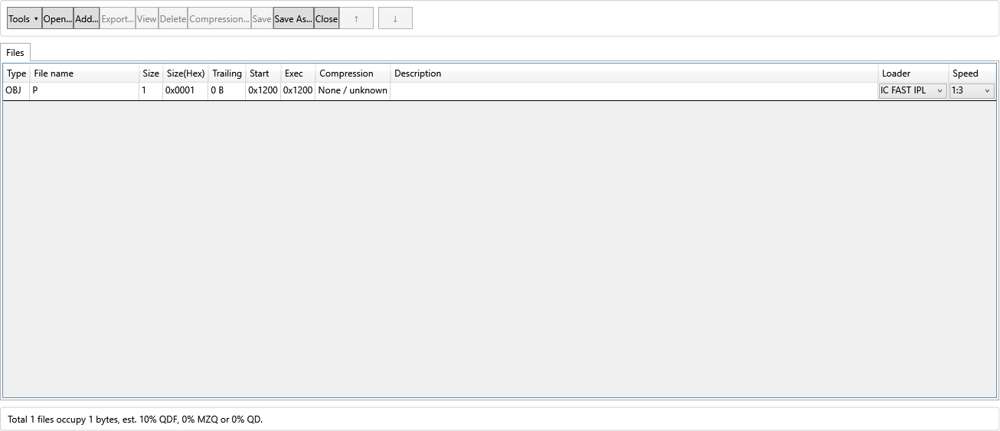

# IC profile names — phase 1

**Subsequent approved update:** [phase 2](IC_PROFILE_NAMING_PHASE2.md) has removed
the three obsolete IC references and the legacy toggle. The scope/results below
record the completed phase-1 state before that separate cleanup.

Date: 2026-10-28. Baseline HEAD: `f8bfff8c62bda60570d9ca39f3e717ee6c69c58e`.
The user approved variant A after the read-only audit. Phase 1 changes presentation,
not the encoded format, timing, loader or framing. Phase 2 remains pending approval.

## What the names mean

| Display name / family | Existing enum(s) | Blocks and loader | Physical timing |
| --- | --- | --- | --- |
| NORMAL 1:1 (ROM) | Normal1_1 | Original header + body; no added loader | Existing ROM800 policy; existing selected machine/region overrides remain |
| NORMAL 1:2–1:4 (IC NORMAL timing) | Normal1_2/3/4 | Original header + body; no IC loader; needs an appropriate already running receiver | Both blocks use exact asymmetric ic2400/ic2800/ic3200 |
| IC FAST IPL 1:1–1:4 | Ic1_1/2/3/4 | Modified ROM-timed header containing the 96-byte IC loader, then body; existing 345 ms delay | Header uses ROM800; body uses ic1200/ic2400/ic2800/ic3200 |
| TC 1:1–1:3 | Tc1_1/2/3 | ROM header + separate 90-byte TC loader + body; existing 110 ms delay | Separate TC timer-derived family; not IC timing |

NORMAL is not renamed to IC NORMAL or TC NORMAL. The current project has no separate
direct IC NORMAL 1:1 enum: Normal1_1 uses ROM timing, while Ic1_1 includes a loader.
No new profile was invented. MZ700 and UL are unchanged. The labels describe MZTools'
existing output structure, not a claim that every framing detail is bit-identical to
the historical copier or that any given resident receiver can load every speed.

The common physical references are **IC writer 1:1**, **1:2**, **1:3**, **1:4**.
They are not four extra loader modes. Baud values remain in source/derivation metadata;
the primary names and speed controls use 1:x. 1:3 and 1:4 are project speed-slot
labels, not exact mathematical 3×/4× scaling.

| Reference ID | Short HIGH / LOW (µs) | Long HIGH / LOW (µs) | IC loader marker |
| --- | --- | --- | --- |
| ic1200 | 234.573 / 263.894 | 469.145 / 494.802 | $4D |
| ic2400 | 113.621 / 139.278 | 234.573 / 260.229 | $20 |
| ic2800 | 87.965 / 124.617 | 175.930 / 223.577 | $16 |
| ic3200 | 76.969 / 117.286 | 157.604 / 179.595 | $11 |

These are the existing catalog values, unchanged. The original source is
[the checked-in copier audit](../specification/CMT_INTERCOPY_TURBOCOPY_TIMING_REFERENCE.md),
§3–8. Its old SD2CMT2 compatibility discussion is historical; the user's newer
statement says current SD2CMT2 uses the precise values. The three `iccompat*` records
are still present in phase 1 and must not be mistaken for current writer timing.
`rxic*` are independent receiver windows and are retained.

## Binary and code evidence

The fixture MZTool.Tests/MZF/Incopy102.mzf hashes to
`B7B8669791A12C0212B046DEFDD37CA1F2687E595589C1CDDF07BDB2EF443439`, matching the source
audit. All 96 bytes of the encoder's IC loader occur together at file offset $21C7.
The four five-byte readpoint/delay rows occur at $1785/$178A/$178F/$1794, including
$4D/$20/$16/$11. This supports the current loader/timing correspondence, including
IC FAST IPL 1:1. It does not certify physical MZ booting or historical menu availability.

`BuildIc` encodes type $BB, length zero, LOAD $1200, EXEC $1110, and copies original
size/LOAD/EXEC to offsets 26–31. `BuildConventional` preserves the original header.
The importer maps the four speed bytes back to the original Ic enums. Both IC and TC
retain their existing payload type/range/overlap restrictions. Phase 1 does not edit
these encoder/importer routines.

## Implementation and review surface

- Mzf.cs: TapeProfileNames owns display names, mode descriptions, physical reference
  names and decoder-label helpers. TapeProfileComponents retains its stable keys
  and speed ordering; SidecarService is unchanged.
- MainWindow.xaml / MainWindow.xaml.cs: a presentation-only item template renders
  key IC as IC FAST IPL. SelectedItem remains the original string, so bulk editing
  and Combine/Split behavior are unchanged. Profile-aware tooltips explain ROM,
  direct asymmetric timing and loader/framing; they refresh when the speed changes.
- Media/PulseReferenceCatalog.cs: shared IC writer names/stage descriptions come
  from that authority. All IDs, numeric values, receiver entries and legacy entries
  remain. WavHeuristicAnalyzer.cs uses central display labels without changing
  classifier references, pass settings or acceptance logic.
- Existing ToDisplayName consumers (batch, analysis, record/candidate tables, reports
  and export errors) receive the same mode labels. They do not write display strings
  into .mfi/.m2i/.mti files.
- Tests: TapeDocumentTests, SidecarServiceTests, SharpTapeExporterTests,
  PulseReferenceCatalogTests and AudioRegionRecoveryTests; STA main-combo checks
  are included in the existing recorder UI smoke executable.

There are 16 new phase-1 unit cases: one identity/order/presentation case, eleven
byte-exact MFI/MTI serialization cases (shared single-record MFI/M2I serializer),
and four direct-versus-IC-FAST-IPL structural cases. The existing 39 WAV/LEP/L16
fingerprints protect exact waveform output, including all NORMAL/IC speeds.
Golden files are not regenerated. The STA check loads a temporary real MZF/MFI pair
and verifies that rendered IC FAST IPL keeps selected key IC and speed 1:3.

## Phase 2 boundary

`iccompat2`, `iccompat3`, `iccompat4` still flow through Entries → Comparisons →
AudioPulseReferences.BuiltIn → manual All profiles / selected references / overlays /
live reference projections and reports. The earlier approved legacy visibility toggle
only affects the comparison combobox; it is not removal. Phase 2 will separately
remove these specific records and dependent paths/tests, after approval, while
retaining exact IC writer references, rxic receiver windows, TC and fast3 references.
The original historical source document will remain a provenance record.

## Validation result

Release solution: zero warnings/errors. Full legacy suite: 1162 passed, 0 failed,
3 missing-fixture skips. Portable capture suite: 191 passed. Windows integration:
44 passed. Combined unit total: 1397 passed / 0 failed / 3 skipped. Recorder STA UI:
74 checks passed. Existing audio-analysis STA smoke also passed. The earlier failed
recorder smoke attempted to inspect a hidden empty grid; its test setup now loads a
real temporary MZF/MFI pair before inspecting the rendered combo. Production logic
was not altered to satisfy that setup failure.

All 39 WAV/LEP/L16 export fingerprints match the unchanged checked-in golden file;
SHA-256 `7B142B0D300DFDAD731032E9DD8A55F900082F84A9789C41C05310EC0E94EB49`.
Sidecar tests pin all eleven NORMAL/IC/TC profile encodings and round trips. Four
structural cases pin the IC header fields and speed bytes for 1:1–1:4, ROM header
pulses, exact body pulses, original payload preservation and shared/direct timing
where applicable. IC 1:1 explicitly differs from ROM NORMAL 1:1. Existing common
loader guards and TC-loader tests remain enabled. The phase-1 additions do not
establish real-hardware boot acceptance or historical menu behavior.

Unit reports are ignored TestResults/IcNamingPhase1/{capture,windows,legacy}.trx.
The main-window screenshot is from the actual recorder STA run:

No changes to TapeFormat.cs, SharpMzPulseDecoder.cs, the TapeProfile enum,
SidecarService encodings, loader bytes, pulse values or framing were made in phase 1.
The original copier audit was retained. No commit/push/release was performed.
