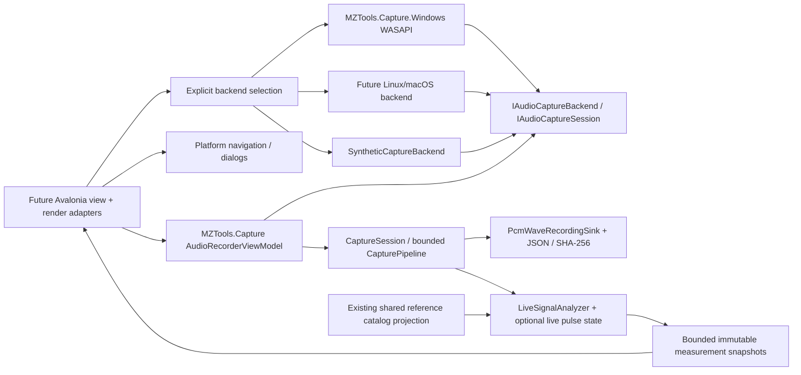

# Recorder adapter boundary for Avalonia / Linux / macOS

Status: stage-G **design specification**, 2026-10-28. No Avalonia package, view or
Linux/macOS capture backend has been implemented or exercised. This document records
the contracts the next port must preserve; it does not select a current package
version or authorize installing a native audio dependency.

The current user-facing behavior is described in the [recorder guide](LIVE_TAPE_RECORDER_GUIDE.md).
The [implementation audit](LIVE_TAPE_RECORDER_IMPLEMENTATION.md) contains algorithms,
test evidence, memory bounds and remaining acceptance items.

## Projects and dependency direction

`MZTools.Capture` targets plain `net10.0` and has no production NuGet dependencies.
It must not acquire WPF, Avalonia, NAudio, native device handles, dispatcher, dialog,
clipboard or shell types. Its only OS interaction is portable file/runtime reporting.
The Windows adapter remains in its own Windows-targeted project. A future platform
backend must not make the portable tests require audio hardware.

Current WPF classes are adapters to replace, not cross-platform models to inherit:

| Current class / responsibility | Future adapter |
| --- | --- |
| `AudioRecorderWindow`: form, native file picker, polling, close prompt | Avalonia view with equivalent state, explicit commands and one UI-owned refresh schedule. |
| `LiveSignalCanvas`: waveform/spectrum drawing and pointer navigation | Renderer over the same bucket/bin snapshots and frame/time transforms. |
| `HeadAlignmentPanel`: controls, evidence tables, two-snapshot A/B graph | View over the existing options, measurements and `HeadAlignmentComparisonModel`. |
| `LivePulsePanel`: settings, reference control, histogram/tables | View over `LivePulseOptions`, `LivePulseViewOptions`, snapshots and catalog DTO projection. |
| `AudioRecorderNavigation`: existing windows + Explorer | Platform implementation of `IRecorderNavigation`; explicit file/folder actions. |
| Windows backend selection in the view | Injected backend factory, never automatic microphone startup. |

The current application/catalog/offline analyzers still reside in the Windows WPF
project. Porting their navigation and catalog provider is **additional work**: an
Avalonia shell cannot reference that WinExe and thereby become cross-platform. Extract
a platform-neutral catalog/offline assembly or provide the already projected reference
DTOs through an approved boundary. Do not copy historical numbers into a second table.

## Existing core API to preserve

| Contract | Required behavior |
| --- | --- |
| `IAudioCaptureBackend.EnumerateDevicesAsync` | Enumerate explicit input IDs/capabilities without starting a microphone. Cancellation and missing devices remain visible. |
| `IAudioCaptureBackend.OpenAsync` | Negotiate and report actual format; format/processing fallback requires explicit permission. Returned session owns native resources. |
| `IAudioCaptureSession.Info` | Requested/actual PCM, device/backend, processing provenance and available native origin/timestamps. Unknown effects stay unknown. |
| `DataAvailable(ReadOnlySpan<byte>, AudioCapturePacket)` | Serialized callbacks; bytes are borrowed only for the synchronous callback. No UI, disk, FFT, logging per sample or recovery in that callback. |
| `StopAsync` / `DisposeAsync` | Quiesce native callbacks before releasing native resources. Repetition is safe, including startup cancellation. |
| `CaptureSession.StartAsync` | Each accepted Start transfers fresh consumer/sink ownership. Rejected/pre-cancelled starts retain caller ownership as documented in current tests. |
| `CaptureSession.StopAsync` | Stop input, drain archive, finalize and await complete report. Its cancellation token cancels waiting, not acquired data. |
| `AudioRecorderViewModel` | Keep Start/Monitor/Record/Stop/Dispose and report history semantics; no UI framework in the model. |
| `RefreshAsync(LiveSignalViewOptions)` | One snapshot refresh at a time. Data processing is off the UI thread; the view marshals rendering to its own UI dispatcher. |
| `ConfigurePulses` | Explicit optional incremental diagnostics, frozen guide lists, new continuity epoch on changed settings; identical settings are idempotent. |
| `IRecorderNavigation` | Open a selected saved audio path through the existing workflows, or explicitly reveal it in a platform file manager. |

Capture PCM is interleaved little-endian, mono/stereo, with the supported sample
representation and valid-bit descriptor. A backend with planar, non-native-endian or
other-channel input must explicitly negotiate/adapt it and document the transformation.
It must never silently reorder/drop channels or present converted data as byte-exact
native capture. PreserveNativeFormat archives the delivered PCM/float bytes and valid-bit
descriptor with the appropriate WAV header. The compatibility float/PCM32 → PCM24
path remains a separate explicit conversion; never substitute it for native archival.

`FirstFrame` is relative to the session. Timestamps are monotonic 100 ns units with
a declared backend origin, not UI wall-clock time. Map native silent/discontinuity/
timestamp flags faithfully; preserve initial native position in stream provenance
where available. Missing audio is not replaced with invented silence. Canonical silence
for unsigned PCM8 is 128; it is zero for signed/float representations.

## View scheduling and lifecycle

One UI thread should own the view's command/configuration calls and await their
completion. Reuse the existing concurrency protections; do not rely on view events
being thread-safe. The view must poll immutable snapshots and must not subscribe to
native capture callbacks for drawing.

Start with the existing 75 ms refresh cadence and single-in-flight guard. Bounded
render work uses min/max waveform buckets, FFT bins and one selected pulse stream.
Changing channel, display gain, tabs or reference viewport must not reset waveform
zoom or duplicate detector passes. Keep archive-loss and preview-loss counters separate.
Run heavy chart preparation off the UI dispatcher and never read a growing WAV for
the live display.

The current core history, ring, FFT and histogram bounds remain the default contract;
new platform/render caches must also be bounded and released on close. Do not retain
`CapturedAudioChunk` memory after `ConsumeAsync` returns. Detectors keep state across
chunks and reset on discontinuity, not on each UI refresh.

An accepted close requests Stop/Finalize and awaits disposal before closing. A declined
close leaves capture running. Cancel pending enumeration/start and prevent late async
results from updating a closed view. Avoid nested close calls inside a framework's
Closing handler; the WPF adapter queues its final Close after that handler returns.
Closing the main browser must not discard an independent active recorder window.
No source device may start merely because a view was constructed or restored.

## Rendering and interaction requirements

- Frame-based time axes, half-open bounds, FS amplitude, dBFS amplitude (not PSD),
  explicit FFT method/resolution and distinct measurement intervals.
- Waveform L/Mono/R/overlay, display-only gain/auto scale, wheel zoom, drag pan,
  rolling history, follow live, trigger/free run and sample-level/min-max rendering.
- Tables with adjustable columns, scrolling and strong selection after focus loss.
- Live-pulse colors and reference strips; no conflation of detector streams,
  measured duration, reference match and accepted decoder bit.
- Head-alignment qualification/rejection and explicit A/B comparability; no absolute
  mechanical angle or synthetic quality score.
- Layouts equivalent to 920×640 and larger windows, actual platform scaling, keyboard
  focus and pointer interactions. Simulated layout scaling is not native DPI evidence.
- Accessible labels/text values for data also shown graphically. Platform tooltips
  must not obscure the pointer's measurement position.

## New backend acceptance gate

For each proposed Linux/macOS transport, first assess the native library/API,
packaging, license, callback ownership, stop/join behavior, raw/processing controls,
timestamp/position semantics and supported device formats. Request approval before
adding dependencies or native code. Windows now has its own exclusive packet transport
alongside the shared NAudio recorder; this does not prove another platform API behaves
identically. Driver-accepted format support is distinct from physical ADC certification.

Before advertising a port, require:

1. Portable tests running on that OS, then device-free backend/transport fault tests.
2. Partition-invariant integer WAV bytes and explicit float/PCM32 conversion vectors.
3. Stop during Start, repeated Stop/Dispose, callbacks after cancellation, device loss,
   format mismatch and archive/preview queue overflow tests.
4. Application UI tests on that platform: no hardware startup, synthetic monitor and
   record, finalized/partial WAV+JSON, navigation spies, close confirmation, layout,
   zoom, tables and repeated view creation/disposal.
5. Physical input acceptance on that OS, including actual rate/channels/processing,
   busy/unplugged devices and a sustained 10–30-minute capture. State hardware
   limitations explicitly until this is done.

WAV segmentation, safe partial retention, integrity reporting, SHA-256 semantics and
offline-reopening compatibility are acceptance requirements rather than optional
rendering details. Cross-platform readiness of source code does not establish a
successful Linux/macOS/Avalonia port; no such PASS is claimed in this stage.
