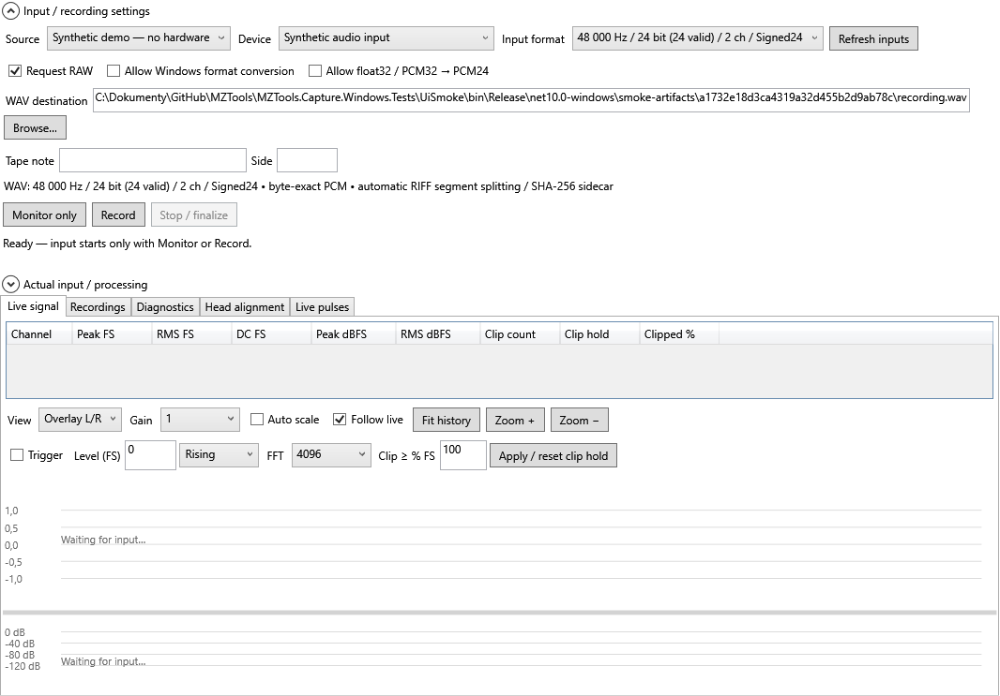
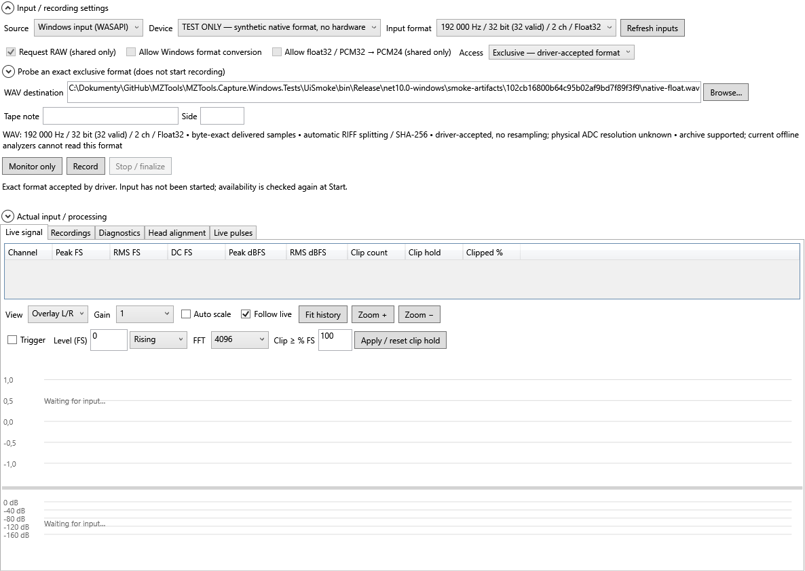
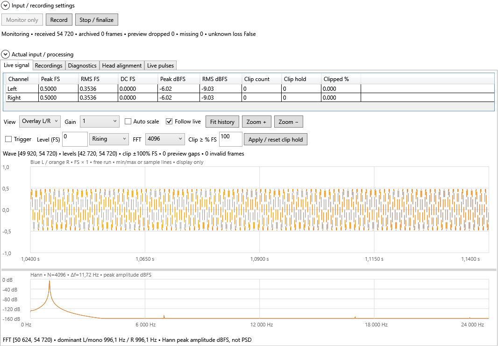
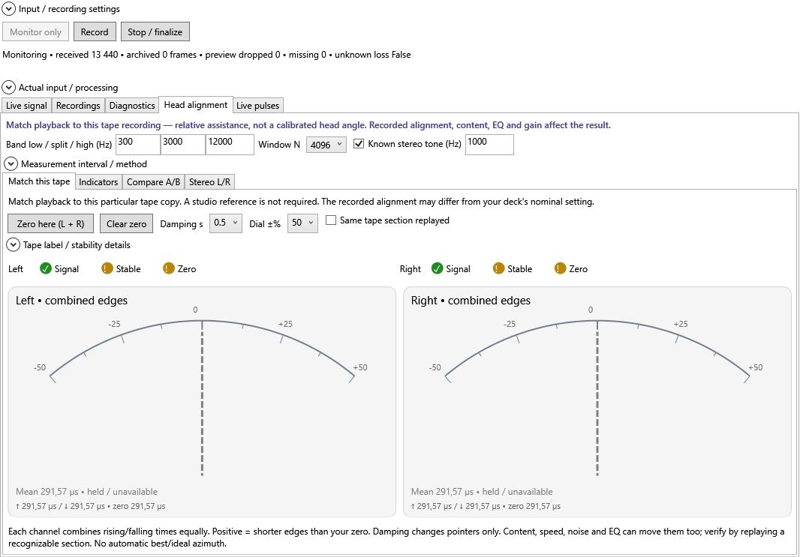
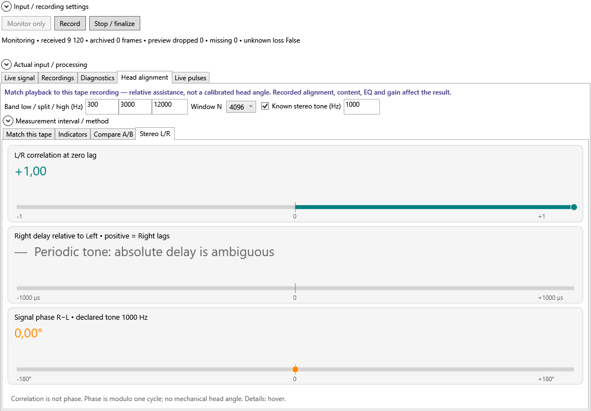
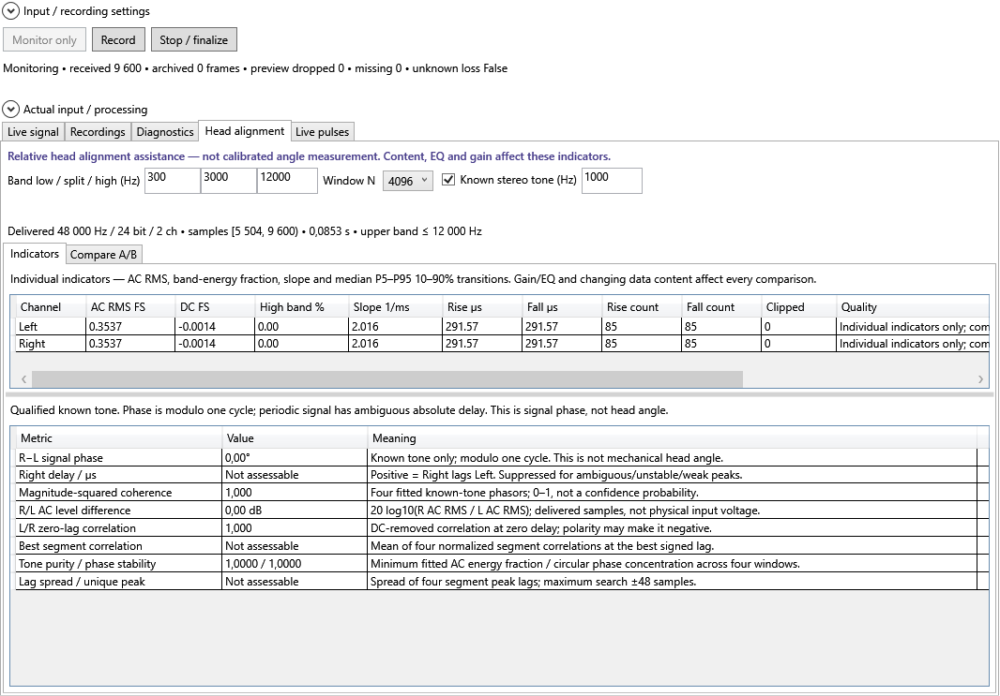
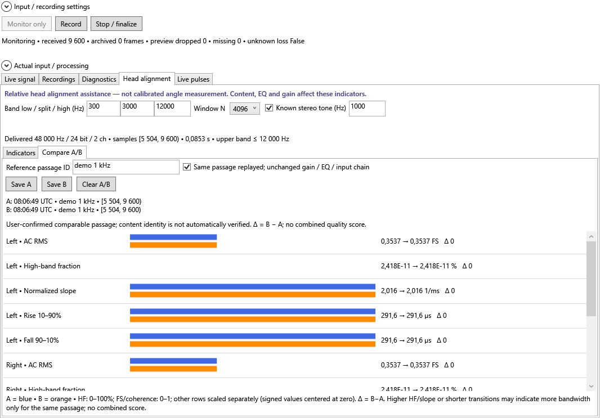
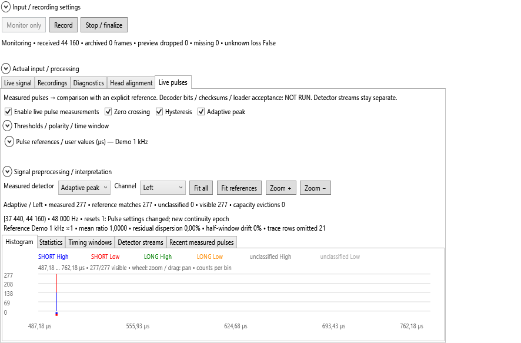
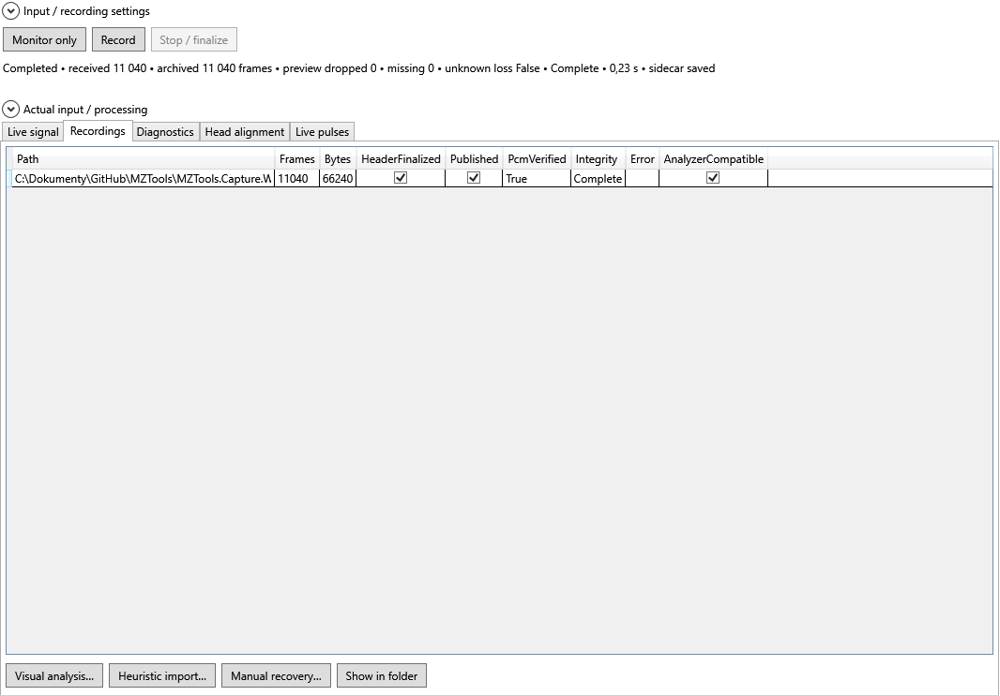

# Záznam kazety a živá analýza

Otevřete **Tools → Record Audio / Live Tape Analysis…**. Okno umožňuje sledovat vstup,
uložit WAV a po zastavení jej předat stávající analýze. Podpora skutečného vstupu je
zatím pro Windows; přenosné výpočty jsou oddělené v knihovně `MZTools.Capture`.

Tento návod popisuje implementaci etap B–G a schválená rozšíření o ručičky L/R a nativní vstup. Automatické a syntetické kontroly recorderu
prošly. **Nahrávání z fyzického zařízení a seřizování skutečné hlavy dosud nebyly
ověřeny na hardwaru.** Po schválených opravách prošlo
1 400 testů bez selhání; tři kontroly se přeskočily kvůli chybějícím referenčním obrazům.
Podrobnosti, příkazy a omezení volitelných kontrol jsou v [implementačním auditu](LIVE_TAPE_RECORDER_IMPLEMENTATION.md#approved-follow-up--profile-reference-picker-and-working-guide-visibility-2026-10-28).

## První vyzkoušení bez zvukové karty

1. V **Input / recording settings** vyberte **Synthetic demo — no hardware**.
2. Vyberte zařízení **Synthetic audio input** a například **48 000 Hz / 24 bit / 2 ch**.
3. Klikněte na **Monitor only**. Uvidíte syntetický tón; žádný WAV se nevytváří.
4. Pro vyzkoušení zápisu zvolte nový název s příponou `.wav` a klikněte na **Record**.
5. Klikněte na **Stop / finalize** a počkejte na dokončení kontroly souboru.
6. V kartě **Recordings** vyberte uložený segment a otevřete jej v další analýze.

Všechny obrázky níže pocházejí ze skutečně spuštěného automatického WPF testu se
syntetickým vstupem, běžně 48 kHz / PCM24 / stereo. Snímek nativních voleb používá
výslovně označený testovací vstup 192 kHz / float32. Jsou to snímky klientské plochy okna,
bez titulkového pruhu; neprokazují funkci žádného fyzického vstupu. Cesty a časy na
snímcích jsou dočasná testovací data.

## Výběr skutečného vstupu a formátu

Ve **Source** vyberte **Windows input (WASAPI)** a následně zařízení ve
**Device**. **Refresh inputs** obnoví nabídku. Otevření okna ani vyhledání zařízení
nespouští záznam; vstup se spustí až tlačítkem Monitor nebo Record. Podporován je
mono nebo stereo vstup.

**Stop / finalize** bezpečně zastaví vstup, při Record dokončí WAV i kontrolu
uložených dat a vrátí nastavení zařízení, formátu a cílového souboru. Zobrazí počet
uložených WAV a cestu prvního souboru; všechny cesty jsou v tooltipu a v Recordings.
Pokud se soubor nepodaří dokončit/publikovat, zobrazí chybu a ponechá částečná data.

**Cancel** při Record nejprve žádá potvrzení zahození aktuální nahrávky. Po potvrzení
zastaví vstup, uzavře zápis a odstraní všechny WAV segmenty i JSON aktuálního běhu,
včetně jeho vlastních dočasných souborů. Dříve uložené nahrávky ponechá. Odmítnutí
potvrzení nechá nahrávání běžet. U Monitoru pouze zastaví vstup bez potvrzení a bez
vytvoření WAV. Po úspěchu vyčistí aktuální náhled a vrátí nastavení. Při chybě mazání
vypíše konkrétní soubor a umožní Cancel zopakovat; nový záznam do té doby nepovolí.
Cancel není mazání již uložených záznamů v Recordings. Samostatné tlačítko
Input / file settings bylo odstraněno. Pouhé rozbalení panelu nastavení vstup nezastaví.

Výchozí **Access → Shared — Windows mix** používá mix formát Windows, který není
zárukou nativního formátu převodníku. V rozbalovacím panelu **Actual
input / processing** po spuštění zkontrolujte skutečně dodaný formát a informace o
zpracování. Počet dodaných platných bitů není záruka fyzického rozlišení převodníku.

| Volba | Význam |
| --- | --- |
| **Request RAW** | Požádá Windows o RAW vstup. Nepotvrzuje transparentnost hardwaru ani veškerého driverového zpracování. Když jej zařízení nepodporuje, chybu uvidíte; zkoušku bez RAW musíte zvolit výslovně. |
| **Allow Windows format conversion** | Pokročilá výslovná volba pro formátový převod ve Windows enginu. Pro výchozí zachování dodaného mix formátu ji nechte vypnutou. |
| **Allow float32 / PCM32 → PCM24** | Povolí nutný převod takového vstupu do PCM24 pro stávající reader/analyzátory. Při převodu může dojít ke kvantizaci či saturaci; výsledek a počty jsou v reportu. |
| **WAV destination** | Cesta pro výstup. Při Recordu s existujícím WAV nebo JSON aplikace nabídne přepsání. Původní nahrávka se nahradí až po úspěšném Stop / finalize. |
| **Tape note / Side** | Volitelné poznámky do JSON reportu. |

Ve sdíleném režimu WAV zachovává dodaný sample rate a kanály. PCM8/16/24 se zapisuje beze změny dodaných
bajtů. Float32/PCM32 vyžaduje výslovné povolení PCM24; aplikace při tom neprovádí
automatický resampling. Záznam pro existující analyzátory podporuje 22 050, 44 100,
48 000, 88 200 a 96 000 Hz. Nepodporovaný výstupní sample rate se odmítne.

### Nativní formát potvrzený ovladačem

1. Zvolte **Access → Exclusive — driver-accepted format**. Nabídka **Input format**
   obsahuje pouze přesné formáty, které ovladač přijal pro exclusive vstup, včetně
   sample rate, kontejnerové a platné bitové hloubky a počtu kanálů.
2. Vyberte požadovaný formát. Například **32 bit (24 valid)** znamená 24 platných bitů
   uložených v 32bitovém kontejneru; archiv zachová celý kontejner.
3. Pro formát mimo běžné předvolby rozbalte **Probe an exact exclusive format**,
   zadejte Hz, kontejner, platné bity a kanály a klikněte **Check exact format**.
   Kontrola nespouští zachytávání; přijatý formát přidá do nabídky. Nabídka není
   úplným seznamem všech možných režimů libovolného převodníku.
4. Spusťte Monitor nebo Record. Obsazené zařízení, zakázané exclusive či nově
   odmítnutý formát způsobí viditelnou chybu; aplikace sama nepřejde na jiný formát,
   zařízení ani shared režim.

Nativní režim obchází sdílený mix a nezapíná PCM24 převod. WAV zachová dodané bajty
PCM8/16/24/32 nebo float32 a původní rate, bez resamplingu; RAW a volby převodu jsou
v tomto režimu nepřístupné. Pro platné bity a 32bitové formáty se podle potřeby používá
WAVEFORMATEXTENSIBLE, pro float také `fact`. Automatické dělení a kontrola SHA-256
fungují i s těmito hlavičkami. Potvrzení ovladačem necertifikuje fyzické rozlišení
A/D převodníku ani zpracování uvnitř zařízení. Rozdíl mezi mix formátem a exclusive
podporou popisují [GetMixFormat](https://learn.microsoft.com/en-us/windows/win32/api/audioclient/nf-audioclient-iaudioclient-getmixformat)
a [IsFormatSupported](https://learn.microsoft.com/en-us/windows/win32/api/audioclient/nf-audioclient-iaudioclient-isformatsupported).

Současné offline analyzátory neumějí všechny archivní formáty: PCM32, float32,
extensible WAV nebo rate mimo podporovanou sadu jsou v okně označené jako
nekompatibilní. Záznam přesto lze uložit a otevřít jeho složku; automatický převod
se neprovádí. Pro přímou offline analýzu zvolte podporovaný plnohodnotný PCM8/16/24
formát. Nativní transport používá vlastní paketovou smyčku nad NAudio.AudioClient;
původní omezení NAudio recorderu pro exclusive se na tuto smyčku nevztahuje.
Recorder nespouští odposlech přes reproduktory ani nemění hlasitost zařízení.

## Monitor, záznam a bezpečné zastavení

**Monitor only** zpracovává živý náhled bez výstupního souboru. **Record** vytváří
archivní WAV. Přechod Monitor → Record nejprve ukončí monitor a otevře nový vstupní
běh; nejde o bezmezerový záznam s předchozí historií.

Při **Stop / finalize** vyčkejte na uzavření vstupu, dopsání přijatých bufferů,
opravu RIFF hlavičky, kontrolu uložených dat a dokončení sidecaru. Zavření aktivního
okna nabídne bezpečné zastavení; odmítnutí ponechá capture spuštěný.
Při samotném **Monitor only** se potvrzení o uchování dat nezobrazuje: WAV nevzniká,
okno pouze bezpečně zastaví vstup a uvolní zařízení. Platí to i při zavření hlavního
okna nebo během rozbíhání monitoru. Potvrzení je určené pro probíhající záznam WAV.

Recorder je navázaný na své hlavní okno stejně jako ostatní inspektory. Zavření
hlavního okna nejprve nabídne zastavení aktivních recorderů a vyčká na dokončení
WAV a ověření dat. Odmítnutí ponechá hlavní okno i záznam otevřené. Při chybě
finalizace zůstanou okna otevřená pro kontrolu zachovaných částečných dat; po
kontrole lze zavření výslovně zopakovat. Samostatné hlavní okno má vlastní recordery.

Před limitem RIFF se výstup automaticky rozdělí na číslované segmenty. JSON report
obsahuje skutečný formát, převod, časové údaje, počty rámců, diagnostiku, cesty segmentů
a SHA-256. Dočasné nebo částečné soubory při chybě zůstávají zachované. Přípona či
existence souboru sama nepotvrzuje úplnost záznamu.

Při potvrzeném přepsání vzniká nový záznam odděleně. **Cancel**, chyba startu nebo
výpadek vstupu původní WAV/JSON zachová. Úspěšné **Stop / finalize** nahradí WAV,
JSON i staré segmenty doložené původním reportem; pokud je nová nahrávka kratší,
nezůstanou její staré pokračovací soubory. Neznámý soubor se stejným pokračovacím
názvem nebo změna původních dat během nahrávání náhradu zablokuje a nové audio zůstane
uložené odděleně. Chyba při nahrazování vyvolá pokus o obnovení původních souborů.

### Souvislá analýza rozdělené nahrávky

Segmenty mohou končit uprostřed pulzu či datového bloku. Žádný PCM rámec se při
dělení neztratí. Ve **Recordings** nyní Visual analysis, Heuristic import i Manual
recovery otevřou vícedílnou nahrávku jako jeden souvislý PCM stream podle jejího
`.wav.json` reportu. Výběr druhého či dalšího segmentu otevře stejný celý záznam.
Přímo lze report otevřít také přes **Open audio / recording…** ve Visual analysis
nebo přes položku Segmented recording v hlavním Open dialogu (heuristický import).

Reader zachová průběžný stav detektorů i globální čísla vzorků přes hranice souborů;
nevytváří velký spojený WAV, nevkládá ticho a nic neresampluje. Stejně fungují výběry,
histogram, ruční hloubková analýza a export oblasti přes hranici segmentů. Export
výběru nadále respektuje velikostní limit jednoho RIFF WAV a nesmí přepsat zdrojový segment.

Vyžaduje se dokončený report, všechny ověřené segmenty stejného podporovaného PCM
formátu a přesná návaznost. Chybějící či změněné soubory, mezery, překryvy a neúplný
záznam se odmítnou. Úvodní kontrola používá SHA-256; její výsledek je cachovaný podle
cesty, délky, času změny a očekávaného hashe, aby se při každém zoomu nečetly znovu
gigabajty dat. Celou složku lze přesunout společně: používají se očekávané názvy
segmentů vedle reportu. Libovolné jiné WAV soubory se automaticky nespojují. Samostatné
otevření jednoho WAV bez reportu nadále analyzuje pouze tento soubor. Dosavadní omezení
offline readeru pro nepodporované nativní formáty zůstávají platná.

V horním stavu rozlišujte **preview dropped**, **missing** a **unknown loss**. Výpadek
náhledu může zanechat archivní data v pořádku, ale přeruší kontinuitu živých měření.
Výpadek vstupních dat nebo přetečení archivní fronty je důvod ukončení s neúplnou
integritou; aplikace nedoplňuje chybějící audio tichem.

## Live signal: waveform, úrovně a FFT

- **View** přepíná Left/Right nebo Overlay L/R; jednokanálový vstup má Mono.
  **Gain** a **Auto scale** ovlivňují pouze kresbu. Auto scale přizpůsobuje každý
  zobrazený kanál jeho aktuálnímu maximu, ignoruje ruční Gain a jeho volbu znepřístupní.
  Po vypnutí obnoví uložené ruční měřítko. Archivní záznam se tím nenormalizuje.
  Stejné ovladače jsou u waveformu ve Visual a Manual WAV/FLAC analýze. Barvy uvádí
  legenda přímo nad grafem: modrá Left, oranžová Right; u mono či smíchaného náhledu
  odpovídající Mono/Mix (při samostatně převedeném pravém kanálu Right).
- Kolečko mění časový zoom, tažení posouvá pohled v omezené historii. **Follow live**
  sleduje nejnovější data; **Fit history** zobrazí dostupnou historii. Změna kanálu
  či gainu časový zoom neruší. Historie náhledu není celá dosavadní nahrávka.
- Aktivní **Fit history**, **Fit all**, **Fit references** a odpovídající Fit tlačítka
  souborových grafů mají modré pozadí, modrý okraj a tučné písmo. Fit all sleduje rozsah
  dostupných dat, Fit references aktuální referenci a Reference scale. Ruční zoom
  nebo tažení příslušný režim vypne a zvýraznění zruší; změna kanálu ani Gain jej neruší.
- **Trigger**, jeho úroveň v FS a Rising/Falling stabilizují zobrazení kolem nalezené
  hrany. Bez vhodné hrany běží pohled volně. Nejde o dekódování kazetového bloku.
- Peak a RMS jsou digitální úrovně v FS/dBFS; DC je průměr v FS. RMS zahrnuje DC.
  Nejde o vstupní napětí line-in ani o kalibrované analogové měřidlo.
- **Clip ≥ % FS** a **Apply / reset clip hold** mění diagnostický práh a vynulují hold.
  Hold počítá analyzované vzorky od resetu; při ztrátě náhledu nepokrývá celý archiv.
- FFT používá Hannovo okno a zvolenou délku. Zobrazuje špičkovou amplitudu dBFS,
  nikoliv PSD nebo automatický odhad šumu. Údaj dominantní frekvence sám neurčuje
  rušení ani správné nastavení hlavy.

U waveformu, úrovní a FFT jsou uvedené jejich intervaly vzorků. Nemusí mít stejnou
délku: úrovně běžně používají posledních 250 ms, FFT posledních N vzorků. Náhled se
obnovuje nejvýše přibližně 13× za sekundu podle výkonu; jeho kadence neurčuje sample
rate ukládaného WAV.

## Head alignment: relativní pomoc při seřízení hlavy

### Match this tape: ručičky pro levý a pravý kanál

Výchozí **Match this tape** pomáhá přizpůsobit přehrávání této konkrétní kopii,
která mohla vzniknout na jiném magnetofonu. Studiová ani ideální referenční nahrávka
není nutná. Sledujte datovou pasáž a stiskněte
**Zero here (L + R)**. Každý použitelný kanál dostane vlastní nulu; mono má jednu
ručičku. Při nevhodném pravém či levém kanálu lze vynulovat pouze použitelný kanál.

Zero lze použít už při prvním čerstvém plném okně s alespoň osmi měřitelnými
náběžnými i sestupnými hranami. Nemusíte vystihnout krátký okamžik ustálení pásky.
U kolísání, šumu nebo meze vzorkování se uloží **uncertain manual zero**; přísné
hodnocení stability a porovnání tím není obejité. Nula vychází z aktuálních mediánů,
nikoli ze starého dobrého úseku. Ticho, clipping, nedostatek hran a chybějící či
zastaralá data nulování blokují. Nejistota uložené nuly zůstává označená, dokud
výslovně neuložíte novou nulu z kvalitního úseku.

Nad ručičkami jsou pro každý kanál stálé grafické kontrolky **Signal / Stable / Zero**.
Zelené ✓ znamená použitelný stav, jantarové ! nejistotu/omezení, červené × nedostupnost
a šedé — chybějící nulu. Podrobnosti jsou v tooltipu odsazeném od kurzoru a pod
**Tape label / stability details**; rychle se měnící text se nad ručičkami nevypisuje.
Kontrolky mají pevný prostor. Ve výběru waveformu je
u sterea **Left / Right / Overlay L/R**, u mono pouze **Mono**; změna popisku
neresetuje zoom.

Každá ručička kombinuje medián náběžné a sestupné doby 10–90 % se stejnou vahou:
`t = (rise + fall) / 2`, změna rychlosti `100 × (t_zero / t_now − 1)` v procentech.
Kladná hodnota znamená kratší hrany proti ručně uložené nule. Aktuální doby obou
hran zůstávají číselně v µs; výrazně opačný vývoj hran vyvolá upozornění. **Damping s**
vyhlazuje pohyb ručičky, nemění měření ani audio; **Dial ±%** mění rozsah stupnice.

Proměnlivý obsah, rychlost pásku, šum, EQ a clipping mohou měření ovlivnit.
Příliš velký rozptyl, překmity, nedostatek hran, mez vzorkování nebo ztráta aktuálních
dat ručičku zneplatní/pozastaví. Výrazná změna hustoty hran nebo tvaru signálu
pozastaví srovnání; aplikace sama neposune nulu. Přehrajte původní úsek nebo nastavte
novou nulu pro jinou stabilní pasáž. Změna vstupu, formátu, měřicích podmínek či
výpadek kontinuity nulu zneplatní. Zastavení zachová poslední polohu šedě jako neaktuální.

Jantarové porovnání je pracovní pomůcka pro měnící se kopii. Příznivý výsledek ověřte
opakovaným přehráním stejného úseku; pokud jej skutečně opakujete, můžete zaškrtnout
**Same tape section replayed**. Je to vaše potvrzení opakování stejné pasáže se
stejným gainem/EQ, nikoli automatické rozpoznávání obsahu nebo jiný výpočet hran.
Změna této volby zneplatní nulu. Potvrzení samo identitu obsahu neověřuje.
Přístroj neurčuje mechanický úhel ani automaticky nejlepší či ideální azimut.

### Stereo L/R: korelace, časový posun a fáze

Karta **Stereo L/R** zobrazuje tři samostatná měření současného enginu:

- **L/R correlation at zero lag** v rozsahu −1 až +1 popisuje korelaci bez časového
  dorovnání. Není to fázový úhel ani důkaz správného nastavení hlavy.
- **Right delay relative to Left** je odhad zpoždění v µs. Kladné číslo znamená,
  že Right zaostává. Zobrazí se jen při průkazném stabilním a jednoznačném vrcholu
  korelace. U periodického známého tónu se absolutní zpoždění neuvádí.
- **Signal phase R−L** ve stupních vyžaduje zapnuté **Known stereo tone (Hz)**,
  skutečnou frekvenci tónu a splněné kontroly čistoty/koherence/stability. Fáze je
  modulo jednu periodu; nejde o mechanický azimut. Pro běžná širokopásmová data se
  nevymýšlí jeden univerzální fázový úhel.

U nepoužitelného nebo zastaveného měření zmizí značka a objeví se pomlčka s podmínkou
dostupnosti; nevzniká falešná nula. Podrobné důvody jsou v tooltipu. Živý interval
je pod sbalitelným **Measurement interval / method**.

### Další ukazatele

Karta **Head alignment** ukazuje jednotlivé ukazatele, ne mechanický úhel. Volby
**Band low / split / high** určují porovnávaná frekvenční pásma; **Window N** měřený
interval. V mono lze sledovat podíl vysokofrekvenční energie, AC RMS, normalizovanou
strmost a doby přechodů. Závisí také na obsahu pásku, úrovni, EQ a elektronice.

U stereo signálu se zpoždění zobrazí jen při dostatečné korelaci, koherenci, jedinečném
vrcholu a stabilitě mezi částmi okna. Kladné zpoždění znamená, že Right zaostává za
Left. Pro **Known stereo tone** zadejte frekvenci skutečně použitého testovacího tónu;
fáze se zobrazí až po jeho kvalifikaci. Periodický tón má fázi modulo jednu periodu,
proto se z něj neuvádí jednoznačné absolutní zpoždění.

**Not assessable** znamená, že podmínky měření nejsou splněny: například ticho,
clipping, rozdílný obsah kanálů, nestabilita, chybná frekvence nebo krátké okno. Ani
kvalifikovaná fáze neprokazuje správný mechanický azimut vůči původnímu záznamu.

### Porovnání A/B

1. Použijte opakovatelnou referenční pasáž. Nastavte stejné zařízení, gain, EQ a vstupní
   zpracování; zvolte stejná pásma, frekvenci a délku okna.
2. V **Compare A/B** vyplňte **Reference passage ID** a potvrďte opakování stejné pasáže
   s nezměněným řetězcem. Potvrzení není automatická kontrola identity obsahu.
3. Při přehrání referenčního úseku použijte **Save A**. Po změně nastavení hlavy znovu
   přehrajte stejný úsek a uložte **Save B**.
4. Porovnejte jednotlivé hodnoty a jejich rozdíl B−A. Změna formátu, nastavení či
   identifikátoru pasáže porovnání zneplatní. Nevzniká souhrnná známka kvality.

A/B uchovává dvě měření pouze v paměti do nahrazení, **Clear A/B** nebo zavření okna.
Nekopíruje audio a neupravuje WAV. Vyšší HF/strmost či kratší přechody mohou ukazovat
na zachování pásma jen pro skutečně srovnatelnou pasáž.

## Live pulses: měření a porovnání referencí

V kartě **Live pulses** zaškrtněte **Enable live pulse measurements**. Zero crossing,
Hysteresis a Adaptive peak jsou nezávislé detektory; jejich zaškrtávátka určují běžící
měření. **Measured detector** a **Channel** vybírají jeden pohled. Po přepnutí jiné
karty již povolené měření pokračuje, dokud jej výslovně nevypnete.

V **Thresholds / polarity / time window** nastavíte škálu dynamického prahu,
adaptivní pásmo kolem nuly, polaritu, délku historie a parametry porovnání. Referenční
časová škála a tolerance mění porovnání délek, nikoliv waveform nebo sample rate.
**Signal preprocessing / interpretation** vysvětluje filtry a měřicí metodu.

**Pulse references / user values** používá společný katalog ROM/kopírek, jeho původ a
kontextové délky. Lze zadat čtyři vlastní délky v µs; ty jsou označené jako uživatelské,
platí v tomto okně a nejsou historicky ověřenými hodnotami.

V běžné nabídce jsou **MZ-800 ROM**, **MZ-700 ROM (PAL/NTSC)**, **NORMAL 1:2–1:4**,
**IC 1:2–1:4**, **TC 1:2/1:3** a **MZ-700 FAST3**. Stejně pojmenované rychlosti IC
a NORMAL používají společné přesné hodnoty; liší se popisem použití v těle nebo
v přímém záznamu. Při volbě obou se stejná fyzická reference testuje jen jednou.
TC v nabídce používá současné přesné řádky časování, nikoli starší kompatibilní hodnoty.
Service nominal, další varianty 1:1 a starší TC porovnávací řádky jsou dostupné
v **Browse catalog / receiver constraints…**, nikoli v běžném výběru. Podrobnosti
jsou pod **Reference details / source**. Názvy skutečných loaderových profilů a
jejich rozdíly nadále popisuje [tabulka režimů a časování](IC_PROFILE_NAMING_PHASE1.md).
Tři zastaralé IC kompatibilní reference byly ve schválené
[fázi 2](IC_PROFILE_NAMING_PHASE2.md) odstraněné z katalogu i ručního **All/Selected
profiles**. Technický katalog má 15 vestavěných porovnávacích referencí; přepínač legacy IC
už není potřeba. Přesné IC writer reference, `rxic*`, TC a FAST3 zůstávají.

Histogram odděluje modré SHORT High, červené SHORT Low, zelené LONG High, oranžové
LONG Low a šedé neklasifikované pulzy. Barevné značky u spodní osy jsou reference.
**Show reference markers / guides** zapíná nebo skrývá osové značky a tečkovaná
svislá vodítka. Mění jen kreslení; zachová měření i rozsah osy a výřez. Najetí na
značku nebo vodítko zobrazí přesnou délku, skupinu a kontext. ROM má více LOW
délek podle leaderu, značky a sousedních datových bitů; blízké červené značky se
mohou překrývat. Nejde o duplicitní profily. [Podrobnosti a ověření](PULSE_REFERENCE_UI.md).
**Fit all** zobrazí celé dostupné rozmezí, **Fit references** zvolené reference. Kolečko
zoomuje u kurzoru, tažení posouvá graf podle celého pohybu myši od začátku tažení,
bez čekání na obnovení měření. Po výběru reference (i uživatelské) se automaticky
provede **Fit references** se zohledněním Reference scale a s okrajem kolem značek.
Změna kanálu ani skrytí značek ručně nastavený výřez nemění.
Tlačítka zoomu drží dominantní viditelný shluk;
statistiky nadále obsahují i pulzy mimo aktuální výřez.

Karty **Statistics**, **Timing windows**, **Detector streams** a **Recent measured
pulses** zobrazují podrobnosti. Sledujte počet změřených, referenčních a neklasifikovaných
délek, resetů kontinuity a omezení historie. Nezapočítávají se dohromady různé detektory
jako další fyzické pulzy. Výpadek náhledu či změna nastavení zahájí nový měřicí úsek.

**Reference match není potvrzený dekódovaný bit, blok ani checksum.** Živá karta
neprovádí plnou recovery. Detektory mohou na stejném signálu dávat různé délky;
adaptivní měření čeká na opačné vrcholy, má omezenou historii a vynechá nedokončené
laloky. Uložený WAV analyzujte dosavadním offline postupem.

## Otevření uloženého záznamu

V **Recordings** vyberte segment s opravenou hlavičkou, nenulovými daty a kompatibilním
formátem. Zkontrolujte integritu, ověření PCM, případné chyby a stav sidecaru.

| Akce | Výsledek |
| --- | --- |
| **Visual analysis…** | Otevře existující vizuální analýzu WAV. |
| **Heuristic import…** | Otevře samostatné hlavní okno a dosavadní heuristický import. |
| **Manual recovery…** | Provede stávající analýzu a otevře ruční recovery nad záznamem. |
| **Show in folder** | Vybere soubor v Průzkumníku. |

Otevření neúplného, ale čitelného segmentu nepotvrzuje úplnost dat. Pokud soubor někdo
mezitím přesunul nebo smazal, aplikace zobrazí chybu. Seznam uchovává posledních 16
reportů v daném okně; nejde o trvalou knihovnu nahrávek.

## Když něco nefunguje

| Projev | Další krok |
| --- | --- |
| V nabídce není vstup | Zkontrolujte mono/stereo vstup ve Windows, zařízení připojte a použijte Refresh inputs. Pro ověření UI použijte demo. |
| RAW otevření selže | Zkontrolujte hlášení; pokud chcete zkusit zpracovaný vstup, výslovně vypněte Request RAW a zopakujte spuštění. |
| Record odmítá float32/PCM32 | Po posouzení převodu zapněte Allow float32 / PCM32 → PCM24, nebo zvolte podporovaný dodaný integer formát. |
| Cíl existuje nebo nelze zapisovat | Zvolte nový název a přístupnou složku. Existující záznam se tiše nenahradí. |
| Waveform vypadá zesíleně/oříznutě | Zkontrolujte display Gain/Auto scale a skutečné měřené úrovně; kresba a archivní PCM mají oddělené cesty. |
| Head alignment hlásí Not assessable | Ověřte energii/clipping, skutečný referenční tón, délku okna a vhodnost obsahu obou kanálů. |
| Histogram je prázdný | Ověřte Enable, povolený vybraný detektor/kanál, aktuální chybu nastavení a Fit all. Viditelné a celkové počty jsou oddělené. |
| Stop trvá déle | Finalizace také ověřuje uložené soubory a hashe. Nezavírejte proces násilně; sledujte stav a chyby. |
| Chyba zařízení/disku | Zkontrolujte Diagnostics a ponechaná částečná data. Neoznačujte záznam za kompletní jen podle existence WAV. |

## Postup ověření na skutečném hardwaru

Následující kroky jsou **plán akceptace, nikoliv hotový výsledek**. Použijte nový
výstupní adresář, vhodný line-in/USB vstup a skutečné zařízení spouštějte výslovně.
Ke každému běhu poznamenejte datum, verzi aplikace, Windows/driver, ID zařízení,
zvolený i dodaný formát, RAW stav, zdroj signálu, výsledek, report a případnou odchylku.

| Kontrola | Požadovaný důkaz |
| --- | --- |
| Enumerace a spuštění | Dostupný/nedostupný/obsazený vstup; podporovaný/nepodporovaný RAW a formát. Žádná tichá změna na jiné zařízení. |
| Exclusive nativní formát | Ověřit nabízené i vlastní formáty, zakázané/obsazené exclusive, skutečný dodaný rate a platné bity. U PCM32/float/extensible ověřit hlavičku a payload externím čtečem, ne nepodporovaným offline analyzátorem. |
| Krátký mono/stereo záznam | Očekávaný počet kanálů, skutečný rate/bit depth, rámce a report; opětovné načtení přes existující reader. |
| Opakované Start/Stop | Několik desítek cyklů, Stop během Start a potvrzené/odmítnuté zavření; žádný zbylý aktivní vstup. |
| Souvislých 10–30 minut | Cesty segmentů, délka podle rámců, integrita, SHA-256, spotřeba paměti a zvlášť archivní/náhledové výpadky. |
| Zatížení UI | Zoom, změny karet, resize a skutečné DPI při záznamu; žádný skrytý vliv kresby na archivní časovou osu. |
| Odpojení a chyba zápisu | Srozumitelný stav chyby, neúplná integrita a zachovaná získaná data. Diskové chyby zkoušejte v řízeném prostředí; nesmí se ničit jiné soubory. |
| Skutečná MZ kazeta | Změřené úrovně a pulzy, otevření uloženého WAV ve Visual/Heuristic/Manual a zaznamenaný výsledek recovery. Neúspěšné dekódování nekvalitní pásky samo nedokazuje chybu recordingu. |
| Srovnatelná pasáž A/B | Stejný řetězec a obsah; doložené změny jednotlivých indikátorů. Žádný odhad absolutního mechanického úhlu. |
| Ručičky pro cizí kopii | Samostatná nula L/R, mono, proměnlivý obsah a opakování stejného úseku; neplatný výsledek při clippingu/šumu a po výpadku. Výsledek neprokazuje ideální azimut. |

Softwarové testy dokládají odolnost proti nepravidelnému doručování bufferů. Neměří
fyzický jitter A/D převodníku, kalibraci hodin ani všechny vlastnosti driveru. Linux,
macOS, skutečné per-monitor DPI a fyzická akceptace zůstávají neověřené.
