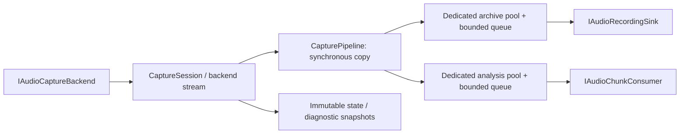

# Live tape recorder — approved stages B–G

Date: 2026-10-27; stage-C compatibility decision updated 2026-10-28.
Baseline HEAD: `12a2520f93e59bfa804a2238b98ecb8942faa23a`.

Current status: B–F are implemented and approved stage G is documented/validated.
See the [user guide and hardware procedure](LIVE_TAPE_RECORDER_GUIDE.md) and
[future Avalonia adapter design](LIVE_TAPE_RECORDER_AVALONIA_ADAPTER.md).
The portable recorder and Windows WASAPI
adapter offer shared/RAW and a separately approved exclusive packet transport with
driver-accepted formats and native PCM/float WAV archival. **NOT TESTED ON HARDWARE.** There is
now a Tools → Record Audio / Live Tape Analysis window with bounded live measurements
and FFT, Head alignment with qualified relative stereo measurements and explicit A/B
comparison, and opt-in Live pulses with independent detector/channel streams. The
sections below retain stage baselines and describe each approved addition. After the
approved graphical-recorder / profile-reference-picker follow-up, the full unit-test run reports **1400 passed,
0 failed, 3 fixture skips**, and all 79 recorder UI checks pass. Earlier exclusive
limitations, stage counts and the original two G failures remain documented as history;
see the approved follow-ups at the end. Physical
hardware acceptance and optional unconfigured branches remain outstanding.

## Stage B — original scope and approval

At this point the user had approved stage B only: portable capture contracts, owned PCM, bounded queues,
synthetic input, lifecycle/state models, independent tests, solution integration and this
document. Windows capture, a WAV writer, sidecar file writing, GUI, FFT, alignment and
live pulse analysis require separate approvals. Nothing records from hardware or creates
an audio file in this stage. No commit, push or source-media modification was performed.

The working tree was clean at the initial audit. Before implementation the user had
changed the application's version from 0.9.8 to 0.9.9 in `MZTools.csproj`; that change
was preserved and is not part of the recorder implementation.

## Architecture and files

`MZTools.Capture` targets plain `net10.0`, with no production NuGet dependencies or
reference to the application. Its public types contain no WPF, Windows, NAudio, dialogs
or dispatchers. Existing audio implementations remain in the application unchanged.



| File | Responsibility |
| --- | --- |
| `MZTools.Capture/MZTools.Capture.csproj` | Portable library, nullable and warnings-as-errors. |
| `MZTools.Capture/AudioCaptureContracts.cs` | Backend, device session, consumer and sink contracts; owned PCM leases and preallocated buffer pools. |
| `MZTools.Capture/AudioCaptureModels.cs` | Requested/actual format, packet timestamps and flags, state, integrity, counters and bounded diagnostics. |
| `MZTools.Capture/CapturePipeline.cs` | Independent archive/analysis workers, copying, frame validation, overflow handling and draining. |
| `MZTools.Capture/CaptureSession.cs` | Start/Stop/Cancel/disposal, resource ownership, snapshots and final report. |
| `MZTools.Capture/SyntheticCaptureBackend.cs` | Explicit synthetic device, selectable deterministic sample function, callback sizes and injected disconnect/discontinuity. |
| `MZTools.Capture.Tests/MZTools.Capture.Tests.csproj` | Independent `net10.0` xUnit project; references only the portable library. |
| `MZTools.Capture.Tests/CaptureSessionTests.cs` | Lifecycle, negotiation, cancellation, disposal, snapshots and portable dependency tests; controlled test backend/sink. |
| `MZTools.Capture.Tests/CapturePipelineTests.cs` | Byte identity, independent consumers, bounded storage, loss evidence and synthetic vectors. |
| `MZTools.csproj` | Reference to portable library; exclude both new projects' source trees from recursive WPF compilation. Existing package versions unchanged. |
| `MZTools.sln` | Add both projects with Debug/Release configurations. |
| `docs/LIVE_TAPE_RECORDER_IMPLEMENTATION.md` | Stage boundary, API, validation and follow-up design. |

Test dependencies use the existing solution's versions: Microsoft.NET.Test.Sdk 17.14.1,
xUnit 2.9.3 and xunit.runner.visualstudio 3.1.4. No capture/audio/native package was added.

## Contract and ownership

* `IAudioCaptureBackend.EnumerateDevicesAsync` returns input descriptors; advertised
  formats are not a certification of ADC resolution. `OpenAsync` returns a fresh stream.
* `AudioCaptureFormat` describes delivered unsigned PCM8, signed PCM16/24/32 or float32,
  mono/stereo, interleaved little-endian storage. Valid integer bits may be fewer than
  their container width; this is not inferred to be physical hardware resolution.
* `AudioCaptureStreamInfo` records requested and actual formats plus processing
  provenance. A different actual format is rejected unless the caller explicitly set
  `AllowFormatFallback`. That permission accepts the backend's reported format; the
  pipeline itself performs no conversion or resampling.
* A backend emits serialized synchronous `DataAvailable` callbacks. The span expires
  when the callback returns. FirstFrame starts at zero per stream. Timestamps use
  monotonic 100 ns units with a backend-defined origin, not UTC.
* The pipeline copies into independent preallocated archive and analysis pools. Large
  packets are split on whole-frame boundaries, retaining offsets, timestamps and flags.
  No PCM interpretation or transformation occurs in either copy.
* `CapturedAudioChunk` belongs to the pipeline. A consumer borrows its read-only memory
  only until `ConsumeAsync` completes, including an asynchronous completion. It must not
  retain the chunk or its memory afterward. Buffers are returned even if a consumer
  throws. Public callers cannot return a pool lease themselves.
* Accepted `CaptureSession.StartAsync` transfers ownership of fresh sink/consumer
  instances. Pre-cancelled or concurrent/rejected starts do not transfer ownership.
  The backend factory is borrowed; each opened device stream is owned and disposed.
* The same controller supports Start → Stop → Start, with a new backend stream and
  fresh consumers per run. The same consumer cannot serve both archive and analysis.
* `StopAsync` cancels pending startup, requests backend quiescence, detaches handlers,
  drains accepted chunks, completes the initialized sink once and disposes resources.
  Repeated Stops await the same final report. Its cancellation token cancels only the
  caller's wait, not archival draining/finalization. `DisposeAsync` is awaitable and
  idempotent and prevents further Starts.
* A cancellation token supplied to Start requests Stop even after startup succeeds.
  Start cancellation before sink initialization is `NotRecorded`, not a completed file.
* Backend `StopAsync` must quiesce callbacks. Late callbacks after teardown are ignored.
  Backend Open/Start must honor cancellation. Consumers must eventually finish their
  operations; this stage does not forcibly abandon an uncooperative in-flight write.

The state model is Idle → Starting → Monitoring/Recording → Stopping → Completed/Failed,
with cancellation and startup-error paths and a final Disposed state. Snapshots can be
polled by a future ViewModel at its own UI cadence; no event calls arbitrary UI code
on the capture thread. Live counter fields can be sampled during concurrent updates;
the final report is taken after draining and cleanup.

## Bounds, errors and integrity

For a branch with queue capacity Q, the pool contains Q + 2 slots (queue, worker and
callback reserve). Each slot holds at most `MaximumChunkFrames * BlockAlign` bytes.
The combined allocation is checked against `MaximumBufferBytes` before starting a
consumer, so a future sink does not create a file for an invalid buffer configuration.
Archive and analysis have separate capacity and cannot retain each other's slots.

`AllocatedBufferBytes` records the PCM pool allocation for the run, not total process
memory, backend buffers, consumer storage or runtime object overhead. After draining,
all leases are returned and the pool's references to available slots are cleared.
`PeakLeasedBuffersUpperBound` explicitly sums the two independent pool peaks; it is
an upper bound, not a claim that both peaks occurred at the same instant.

Archive overflow stops acceptance immediately, records `ARCHIVE_OVERRUN` with the
first rejected frame and remaining delivered-frame count, asynchronously requests Stop,
then drains retained data. A device gap or discontinuity similarly stops without adding
invented silence. Known gaps and unknown-length loss are distinguished. Received,
accepted and successfully written counts remain separate; write failure cannot claim
that unwritten queued samples reached the sink.

Analysis overflow drops an old queued display chunk, with exact dropped-frame counters.
The surviving chunks retain original frame offsets, so a future streaming analyzer
must reset continuity across display gaps. Analysis failure is a persistent warning
during recording, with archival integrity preserved; in monitor-only mode it is a
terminal failure. There is no per-sample or per-packet disk logging.

Device loss, invalid alignment/counts, overlapping frame indices, reliable timestamps
moving backwards, mismatched format and sink errors have distinct diagnoses. Source
silence flags are preserved; a backend must provide the actual silence representation
in the callback data. Unreliable timestamps are marked once, not misrepresented as an
exact lost-frame count. Diagnostics retain a configured number of entries and count
omissions after that cap.

`CaptureIntegrity.Complete` means that every received valid frame reached the sink
without a terminal capture error. `SinkFinalized` means that the sink's completion
operation returned successfully; **neither field certifies a WAV in stage B**, which
has no WAV writer. An incomplete sink may still finalize successfully to preserve a
future partial file. A failing or cancelled startup never silently claims a saved WAV.

## Validation — Windows, .NET SDK 10.0.303 / runtime 10.0.11

Final checks for stage B:

| Check | Passed | Failed | Skipped |
| --- | ---: | ---: | ---: |
| Portable capture tests | 55 | 0 | 0 |
| Existing targeted audio tests, as reported by xUnit | 247 | 0 | 0 |
| Release solution build | 0 warnings, 0 errors | 0 | — |

The extended transfer test feeds an accelerated **30 minutes of synthetic mono PCM16
at 48 kHz**: 86,400,000 frames / 172,800,000 bytes, through 30,000 packets. It keeps no
recording-sized PCM collection, checks the complete input/output SHA-256, and verifies
the fixed 23,040-byte PCM pool allocation, zero outstanding leases and clean integrity.
This is not a 30-minute wall-clock soak test and not a hardware recording. The complete
55-case capture run including this test took approximately 0.71 seconds in this host.

Other tests cover all ten representation/channel combinations, overwriting borrowed
source buffers after callbacks, split-packet offsets, deterministic synthetic sample
vectors, DC/pulses/noise/channel delay, slow analysis and archive consumers, every
lifecycle phase, writer failure, finalizer failure, device loss, actual-format fallback,
bounded diagnostics, pre-cancellation and late/disposed callbacks. The dependency test
checks plain net10.0 and the absence of application/WPF/NAudio/Windows assemblies.

The existing regression run includes `AudioReferenceBaselineTests` and its 39 immutable
WAV/LEP/L16 export fingerprints. They match the checked-in golden; no golden was
regenerated. Existing heuristic, manual, pulse catalog, decoder and selection tests ran.
Four older environment-gated checks return early without fixtures and are counted as
PASS by their existing implementation; their real-capture branches were **NOT RUN**:

* `AvailableHeaderlessFixture_PreservesDocumentedPayloadFingerprint` —
  `MZTOOLS_P0_HEADERLESS_FIXTURE` not configured.
* `RealHeaderlessFixture_KnownLengthMatchesOriginalProgramWhenConfigured` —
  `MZTOOLS_HEADERLESS_FIXTURE` not configured.
* `RealCapture_StandardHeuristicAndManualParityAuditWhenConfigured` and
  `RealSelection_HeuristicAndLocalManualMatchValidatedOriginalBytes` —
  `MZTOOLS_AUDIO_RECOVERY_FIXTURE` not configured.

Those four checks are not claimed as independently validated capture evidence. Existing
tests were not modified to change their reporting. DSK/QD/HFE algorithms and UI were
unchanged; disk and UI suites were not rerun in this non-UI stage.

Commands:

```powershell
dotnet build MZTools.sln -c Release --verbosity minimal
dotnet test MZTools.Capture.Tests/MZTools.Capture.Tests.csproj -c Release --verbosity minimal -- 'RunConfiguration.DotnetHostPath=C:\Program Files\dotnet\dotnet.exe'
$env:MZTOOLS_REFERENCE_FINGERPRINTS = $null
$env:MZTOOLS_HEADERLESS_AUDIT = $null
dotnet test MZTool.Tests/MZTools.Tests.csproj -c Release --no-build --no-restore --filter 'FullyQualifiedName~AudioSignalAnalysisTests|FullyQualifiedName~AudioReferenceBaselineTests|FullyQualifiedName~AudioRegionRecoveryTests|FullyQualifiedName~AudioHeaderlessRecoveryTests|FullyQualifiedName~AudioSelectionTests|FullyQualifiedName~WavHeuristicAnalyzerTests|FullyQualifiedName~SharpMzPulseDecoderTests|FullyQualifiedName~SharpTapeExporterTests|FullyQualifiedName~PulseReferenceCatalogTests' --verbosity minimal -- 'RunConfiguration.DotnetHostPath=C:\Program Files\dotnet\dotnet.exe'
git -c core.safecrlf=false diff --check
```

The host's native `testhost.exe` failed to establish its VSTest connection before any
tests began. Forcing the existing dotnet host with the supported RunConfiguration
setting resolved that issue without changing dependencies or test semantics. Initial
diagnostic attempts were aborted before executing tests; they are not PASS results.
During diagnosis only generated testhost EXEs were renamed to `.saved`; a subsequent
build restores them. The final commands above work with the normal generated files.
On Linux/macOS, use the portable test command without the Windows-specific host-path
override. Those OS executions have **NOT BEEN RUN** in this Windows workspace.

Hardware capture, real-time latency, actual driver formats, disk-full recovery,
WAV readability/finalization and UI FPS are **NOT TESTED ON HARDWARE / NOT IMPLEMENTED
IN STAGE B**. Stage B does not assert RMS/FFT/alignment measurement accuracy.

## Reuse boundaries and next approvals

Existing WAV/FLAC readers, Visual/Manual workflow and exporters are unchanged. Their
signed 24-bit normalization and full-scale semantics remain the integration reference.
The seekable reader is not presented as a live reader; the offline signal analyzer is
not run in a capture callback. `TapeFormat.WavSink` creates encoded tape waveforms,
and `AudioSelectionWaveExporter` exports an existing selection: neither substitutes
for an archival recorder with partial-file finalization.

`PulseReferenceCatalog` remains the sole historical numeric source. No historical pulse
table, detector, decoder acceptance rule or PCM preprocessing was added or duplicated.
The current pulse engine's cumulative exact-duration dictionary is not a bounded live
histogram. Stage F must adapt measurement/detector continuity to sliding windows and
receive catalog projections through an application bridge, avoiding a reverse Core→WPF
reference or a copied numeric catalog. Such work is not part of stage B.

Proposed C: a Windows-specific adapter using pinned NAudio.Wasapi 3.3.0/WasapiRecorder;
verify the resulting shared NAudio.Core upgrade against SoundFile 3.1.0 before release.
Use explicit input endpoints, raw/exclusive capability reporting, and persistent
processing provenance. Add compatible PCM WAV writing, explicit deterministic
float32/PCM32→PCM24 conversion when needed for compatibility, frame-aligned numbered RIFF segments, sibling temporary
files, partial-file preservation/finalization and sidecar JSON with hashes/evidence.
No promise can guarantee a valid header when the storage itself cannot be written;
report finalization failure and retain acquired data rather than falsely declaring
success. Stage C requires fresh approval including its dependency and conversion policy.

Subsequent D adds the WPF adapter/ViewModel, waveform/meters/FFT and integration with
existing offline tools; E adds relative alignment evidence; F adds live pulse analysis.
Avalonia can reuse this assembly and future portable ViewModels without referencing
WPF. Linux/macOS require their own backend and hardware acceptance, possibly using
PortAudio with separately distributed native assets; no native assets were added here.

API/backend sources audited on 2026-10-27:

* [NAudio.Wasapi 3.3.0](https://www.nuget.org/packages/NAudio.Wasapi/3.3.0)
* [Version-pinned WasapiRecorder documentation](https://github.com/naudio/NAudio/blob/v3.3.0/Docs/WasapiRecorder.md)
* [NAudio license](https://github.com/naudio/NAudio/blob/v3.3.0/LICENSE)
* [PortAudio API overview](https://portaudio.com/docs/v19-doxydocs-dev/api_overview.html)
* [PortAudio license](https://portaudio.com/license.html)
* [VSTest dotnet-host selection](https://github.com/microsoft/vstest/blob/v17.14.1/src/Microsoft.TestPlatform.TestHostProvider/Hosting/DotnetTestHostManager.cs)

Stage B was completed and the user subsequently approved stage C as described below.

## Stage C — Windows input and archival WAV

Approved scope: isolated Windows WASAPI input, NAudio.Wasapi 3.3.0/Core 3.3.0 compatibility,
input/format selection, compatible PCM WAV, explicit conversions, RIFF segmentation,
safe partial-file handling, sidecar JSON, tests and documentation. No GUI, FFT, head
alignment, live pulse decoding or playback monitoring was added. No hardware input
was started during implementation or tests.

### Files and dependency boundaries

| Files added/changed in C | Purpose |
| --- | --- |
| `MZTools.Capture/AudioPcmQuantizer.cs` | Explicit conversion plan and deterministic PCM24 conversion; integer pass-through unchanged. |
| `MZTools.Capture/WaveRecordingModels.cs` | Recording options/results, storage fault-injection seam, RIFF frame/size arithmetic and report-sink contract. |
| `MZTools.Capture/PcmWaveRecordingSink.cs` | Streaming WAV, temporary siblings, segmentation, source/file/PCM hashes, recovery and sidecar transaction. |
| `MZTools.Capture/AudioCaptureModels.cs` | Processing provenance, initial native origin, recording results and initial packet flags. |
| `MZTools.Capture/CapturePipeline.cs` | Persistent initial-position/transition warnings without fabricating missing samples before the archived interval. |
| `MZTools.Capture/CaptureSession.cs` | Refresh actual backend metadata after Start/Stop; write final sidecar after consumer cleanup; sidecar failure is explicit. |
| `MZTools.Capture.Windows/MZTools.Capture.Windows.csproj` | Windows-only adapter library, no WPF; pinned NAudio.Wasapi 3.3.0. |
| `MZTools.Capture.Windows/WindowsAudioCaptureBackend.cs` | Async adapter/lifecycle, native packet flags, bounded canonical silence, relative frame positions and diagnostics. |
| `MZTools.Capture.Windows/WasapiCapturePlatform.cs` | Actual NAudio enumeration, native format mapping, explicit negotiation and recorder construction. |
| `MZTools.Capture.Tests/WaveRecordingTests.cs` | Portable writer, conversion, hashing, segmentation and storage-failure tests. |
| `MZTools.Capture.Windows.Tests/*` | Separate Windows test project; simulated transports and actual reader/analyzer round trips. |
| `AssemblyInfo.cs` | Friend access for the Windows integration tests to existing internal readers/analyzer. |
| `MZTools.csproj`, `MZTools.sln` | Adapter/test projects, recursive compilation exclusions, dependency integration and copying notices with built/published output. |
| `THIRD_PARTY_NOTICES.md` | NAudio MIT notice. |

The resolved application graph now uses NAudio.Wasapi **3.3.0** and NAudio.Core **3.3.0**.
NAudio.SoundFile remains **3.1.0** and the libsndfile win-x64 runtime remains **1.2.2**.
No broad package upgrade, PortAudio or new native binary asset was introduced. The
existing FLAC/WAV equivalence test passed before further implementation and again
in the full targeted audio regression run. The portable capture library still has
**no NuGet/Windows/WPF/application dependency** and remains `net10.0`.

### Input negotiation and processing provenance

`WindowsAudioCaptureBackend` enumerates **active capture endpoints**, never render
endpoints/loopback. Enumeration/Open do not start a microphone. There is no default
device switching, automatic stream routing, volume adjustment or communications-mode
AGC/AEC request. The device ID must be selected explicitly.

The default is shared mode, RAW requested, and no application-requested engine
conversion. Shared capture uses the actual endpoint mix format. If a requested format
differs, the caller must explicitly allow fallback to the mix format or explicitly
permit shared-engine rate/sample-format/channel conversion. Advertised formats are
container/API support, not a measurement of the ADC's physical bit resolution.

On 2026-10-28 the user authorized choosing the more reliable/compatible option after
the exclusive API incompatibility was reported. This implementation chooses **shared
input with RAW requested and the exact endpoint mix descriptor**, keeping engine
conversion disabled by default. `SupportedModes` exposes only Shared. An explicit
Exclusive request fails before device enumeration/Open/Start; the unsupported native
branch and its format probes were removed. No experimental exclusive transport or
additional package was introduced, and there is no silent exclusive→shared fallback.

The reason is verified against NAudio 3.3.0 source and Microsoft contracts:
WasapiRecorder's packet reader calls GetNextPacketSize, which supports shared streams
only; its standard initialization also supplies zero periodicity, invalid for exclusive
event-driven capture with nonzero buffer duration. A format probe alone therefore
cannot certify that exclusive recording works. Simulated format tests were replaced
with rejection-before-open checks rather than being presented as hardware evidence.
See [NAudio packet loop](https://github.com/naudio/NAudio/blob/v3.3.0/src/NAudio.Wasapi/WasapiRecorder.cs#L609),
[GetNextPacketSize](https://learn.microsoft.com/en-us/windows/win32/api/audioclient/nf-audioclient-iaudiocaptureclient-getnextpacketsize)
and [Initialize](https://learn.microsoft.com/en-us/windows/win32/api/audioclient/nf-audioclient-iaudioclient-initialize).

RAW support is established only by successful native stream initialization. Unsupported
RAW does **not** silently retry in a processed mode. The caller may explicitly choose
`RequestRaw = false`, in which case processing provenance warns about possible
enhancements, AGC, noise suppression and echo cancellation. Even initialized RAW does
not certify removal of always-on endpoint, driver or hardware processing. Engine mix
format is the format observed at Open, not a hardware clock/resolution measurement.

Backend construction and native startup run off the UI thread. NAudio's stop request
alone does not join callbacks; the adapter awaits its asynchronous disposal/join before
declaring Stop complete. Native initialization itself is a synchronous OS/driver call:
cancellation waits for that call to return before freeing its resources. No unsafe
abort or disposal underneath an in-progress native call is attempted.

Each archived stream begins at its **first delivered packet**. The original native
frame origin, first QPC timestamp in 100 ns units and first packet's receive UTC are
retained. A nonzero origin emits `INITIAL_POSITION_OFFSET`: earlier device frames
were not supplied and are outside the archived interval. An initial discontinuity
flag emits a warning; there is no preceding archived interval to quantify its loss.
Neither warning claims that recording began at native stream frame zero. Gaps and
discontinuities **after** this boundary stop recording and report known/unknown loss.
Timestamp-error flags remain explicitly unreliable. Device-invalidated HRESULTs are
reported as DeviceLost with the native code.

WASAPI SILENT packets have undefined payload bytes and are materialized as specified
silence: 128 for unsigned PCM8, zero for signed PCM/float. This semantic representation
is separately flagged; it is not repair of a dropout. The adapter's preallocated
silence buffer is configurable/bounded (default 65,536 frames; at most 524,288 bytes
for stereo float32). Oversized silent packets are frame-aligned slices with original
offsets; normal packets are borrowed directly until the capture callback returns.

### PCM conversion and compatibility

* PCM8/16/24 preserves the delivered bytes, actual rate and channel count. No filtering,
  normalization, DC removal, mixing or resampling enters the recording path.
* Float32/PCM32 requires **`AllowPcm24Conversion = true`**. Otherwise Start fails before
  any output file is created. Source format and output quantization remain separate.
* Float32 scales by 2^23; signed PCM32 scales by 1/256. Rounding is nearest with
  midpoints away from zero, saturation to [-8388608, 8388607], and **no dither**.
  Non-finite floats stop recording instead of being replaced by invented samples.
* Declared unused integer padding bits are ignored before conversion. A PCM32
  container holding at most 24 valid left-aligned bits can be repacked without loss
  of its valid bits; a full-width PCM32/float32 conversion may lose precision.
  Saturated output sample count is distinct from a future input clipping metric.
* Writer conversion storage is 64 KiB by default, explicitly limited to 8 bytes–1 MiB.
  Read-back hashing uses one 128 KiB buffer. These and backend buffers are additional
  to the pipeline's explicitly reported PCM pool allocation.
* By default only current-reader rates 22050/44100/48000/88200/96000 Hz are accepted.
  An advanced caller can explicitly disable that compatibility restriction to archive
  another actual rate; the result is marked AnalyzerCompatible=false. It is never
  silently resampled. Float/RF64 reader changes were not made.

### WAV transactions, segmentation and failures

The writer creates a unique temporary sibling ending in `.partial.wav`, with an initial
RIFF/fmt/data header. Existing WAV or sidecar destinations cause failure; no overwrite
mode exists. A segment is flushed, its actual stored frame count/header verified, and
then moved to its final name with overwrite disabled. Destination collisions preserve
both the existing file and the new temporary recording. Successful names are the
requested `name.wav`, then `name_002.wav`, `name_003.wav`, etc.

All counters/offsets are 64-bit. The RIFF/data UInt32 fields, whole-frame capacity and
odd-byte word padding are checked before narrowing. Rotation happens before the
RIFF limit; frame offsets continue across segments. No RF64 is written. Tests exercise
actual rotation with small limits and near-4-GiB arithmetic with fake frame counts,
without allocating gigabytes.

The live writer updates source/expected output PCM hashes incrementally. **It does not
read an entire closed segment during capture**. Full file/PCM SHA-256 and payload
read-back validation run after capture and queue draining stop. This prevents a 4-GiB
hash read from blocking the writer at a live segment boundary. Each normal segment's
actual PCM is compared with its incrementally hashed written bytes; closed-file
modification is detected before declaring completion. A slow/failing storage device
can still overrun the finite archival queue; that is an explicit terminal integrity
failure, never an unbounded queue or silent data loss.

On capture/device/writer error, the sink attempts to finalize the actually stored
prefix and retains its partial filename. A write may fail partway through a frame:
the full-frame prefix is declared as WAV PCM and remaining acquired bytes are retained
in place after it, with `trailingPartialFrameHex` recording the fragment. No acquired
audio file is deleted or silently truncated. Such a partial file can contain trailing
bytes outside the RIFF data/container (or occupying its padding); it is not represented
as a pristine normally published segment. Its complete file hash includes those bytes.

If storage cannot reopen/rewrite/flush the header, the partial file remains and
HeaderFinalized/SinkFinalized do not claim success. Valid headers cannot be guaranteed
when the storage itself rejects writes. Empty recordings retain a valid empty partial
WAV, have NotRecorded status and are not offered as compatible nonempty analysis input.
`AnalyzerCompatible` means readable format/nonempty finalized audio, not a claim that
the MZ data or checksums decode successfully.

### Sidecar and evidence

The initial sidecar is a temporary sibling marked Recording. After device, pipeline,
sink and consumer cleanup, the optional `ICaptureSessionReportSink` receives the final
report, writes the JSON and atomically publishes `name.wav.json` without overwriting.
The sink's post-disposal hook uses retained immutable results, not disposed audio/hash
handles. Failure to write or publish JSON produces `SIDECAR_WRITE_FAILED` and retains
available metadata/audio; it cannot turn into silent success. A `.partial.json` is an
uncommitted journal/transaction, not proof that its planned final path was published.

The JSON contains schema `mztools-live-capture-v1`, start/end UTC, monotonic lifecycle
elapsed, first-packet timing, saved duration from frames/rate, selected endpoint/backend,
requested/actual/output formats, RAW/engine/processing provenance, application version,
OS/runtime/architecture, optional tape/side notes, diagnostics/omissions, all frame/byte
counters, segment offsets/paths, finalization state and SHA-256 values.

Source PCM hash covers the **original source blocks observed by the archive sink**,
not dropped packets that never reached it. Its SourceFramesHashed/SourceBytesHashed are
explicit: a failed partial write can hash an entire attempted block while saving only
its prefix. Output/file hashes instead cover actual stored bytes. The complete-coverage
flag refers to **frames**, not byte equivalence between float32 input and quantized
PCM24 output. `PcmMatchesWrittenBytes` is null where a partial failed block prevents a
complete expected-output comparison. Source completeness, file validity, checksum and
successful MZ recovery are separate concepts.

Report end UTC/elapsed are frozen after capture/file cleanup, before publishing the
sidecar, so returned report and committed JSON agree. Lifecycle elapsed includes Open
and file finalization; it is not substituted for the sampled audio duration.

### Sample timing versus callback jitter

Archive sample positions follow the device's frame order and reported sample rate.
Callback arrival times, UI cadence and lifecycle wall-clock elapsed are not used to
stretch pulses, resample, duplicate samples, insert silence or correct the recording
clock. This is protection against **software packet-delivery jitter**, not a claim of
zero physical A/D clock jitter or a calibrated hardware clock. The recorder cannot
remove physical jitter, recover audio never supplied by the driver, or guarantee
that an external input/device/storage never stalls. A detected gap/overrun stops with
explicit incomplete integrity rather than disguising the loss.

The packet-jitter tests record the same 4097-frame square-pulse signal using one large
packet versus irregular packets separated by real asynchronous delays, while the
preview consumer is deliberately blocked. For PCM16 mono and float32 stereo (explicit
PCM24 conversion), both recordings have identical WAV bytes, file/source hashes and
saved frame count; every left-channel transition stays at its original 24-frame
boundary. Display frames are dropped with counters while archival frames are retained.
This test does not measure driver latency, wall-clock sample-rate accuracy or ADC jitter.

### C validation results

| Final check | Passed | Failed | Skipped |
| --- | ---: | ---: | ---: |
| Portable capture/recording tests, including B | 95 | 0 | 0 |
| Windows adapter + reader/analyzer integration tests | 32 | 0 | 0 |
| Existing targeted audio regression tests | 247 | 0 | 0 |
| Release solution build (six projects) | 0 warnings, 0 errors | 0 | — |

The same four optional real-capture branches listed in the B report remain unconfigured
and **NOT RUN**, despite their old tests reporting PASS. No source fixture/golden was
rewritten. The 39 WAV/LEP/L16 fingerprints still match. The existing FLAC decoder,
heuristic/manual algorithms, reference numbers and disk formats were unchanged.

New checks include all compatible integer widths/channels, actual-vs-requested format
fallback, source/output hashes, midpoint and full-scale vectors, half-LSB quantization
error, valid-bit padding, non-finite rejection, segmentation/odd padding, atomic collision
protection, partial disk-full writes, persistent finalize failure, sidecar failure,
native silence/flags, device loss, cancellation during native Start, and no full-file
read at live rotation. Simulated MZ tape capture reloads in Standard import and Visual
analysis with the original 128-byte header and payload. PCM8/16/24 and converted float
WAVs reopen in the actual existing reader/analyzer, including odd PCM8/PCM24 mono sizes.

Commands used after the Release build (host-path override is local to Windows testing):

```powershell
dotnet build MZTools.sln -c Release --verbosity minimal
dotnet test MZTools.Capture.Tests/MZTools.Capture.Tests.csproj -c Release --no-build --no-restore --verbosity minimal -- 'RunConfiguration.DotnetHostPath=C:\Program Files\dotnet\dotnet.exe'
dotnet test MZTools.Capture.Windows.Tests/MZTools.Capture.Windows.Tests.csproj -c Release --no-build --no-restore --verbosity minimal -- 'RunConfiguration.DotnetHostPath=C:\Program Files\dotnet\dotnet.exe'
# Existing audio filter is the same full filter recorded in the B commands above;
# use that command with the current restored NAudio.Core 3.3.0 dependency graph.
git -c core.safecrlf=false diff --check
```

All Windows transport tests use simulated transports. **NOT TESTED ON HARDWARE:** actual
device enumeration/driver negotiation/shared/RAW behavior, busy/unplugged hardware,
real-time callback latency, sustained 10–30-minute recording and physical tape recovery.
Storage failures are deterministic injected filesystem/stream faults, not a claim that
every real filesystem/power-loss behavior was reproduced. UI/FPS and Linux/macOS capture
remain outside C and were not tested. The next hardware acceptance should cover mono/
stereo PCM16/24 and float mix formats, unplug/busy/unsupported RAW, repeated Start/Stop,
long capture, and finalized/partial reopening before claiming a hardware PASS.

### API use and next approval

The C API is functional without a recorder GUI. After explicit device/format/path
selection by a caller, a typical sequence is:

```csharp
var backend = new WindowsAudioCaptureBackend(new() { RequestRaw = true });
var devices = await backend.EnumerateDevicesAsync(); // Does not start a microphone.
// User selects selectedId and an actual supported AudioCaptureFormat named format.
await using var capture = new CaptureSession(backend, new(selectedId, format));
var sink = new PcmWaveRecordingSink(new(destinationPath) {
    AllowPcm24Conversion = userApprovedConversion,
    ApplicationVersion = applicationVersion
});
await capture.StartAsync(sink); // Explicit user action starts the selected input.
// ...
var report = await capture.StopAsync(); // Also awaits verification and sidecar outcome.
// Check report.Integrity, report.Recording and diagnostics before offering saved paths.
```

The D proposal, subsequently approved by the user: portable bounded live waveform/levels/FFT analyzer
and ViewModel/snapshots; WPF recorder window with explicit input and requested/actual/
output settings, Monitor/Record/Stop, status/diagnostics, synthetic demo, resize/zoom/
DPI controls, safe close confirmation and links to existing Visual/Heuristic/Manual
workflows and folder navigation. New files would center on `LiveSignalAnalyzer.cs`,
portable live models/ViewModel, `AudioRecorderWindow.xaml/.cs` and a WPF rendering/
platform-actions adapter, plus focused numerical/lifecycle/UI tests and the main Tools
entry. FFT can use System.Numerics without a new audio dependency. No head-alignment
score or live pulse decoding is included in D; those remain separate E/F approvals.

Stage D was explicitly approved. Release, commit and push are not authorized.

## Stage D — recorder window and bounded live analysis (2026-10-28)

The approved D implementation adds no packages. `System.Numerics.Complex` provides the
FFT arithmetic. The core library still targets plain `net10.0`, without WPF, NAudio,
Windows, dialogs, dispatchers or filesystem shell actions. No historical pulse values
or decode algorithms were changed. Head Alignment and live pulse recognition are not
part of D.

### Files and integration

| File | Responsibility |
| --- | --- |
| `MZTools.Capture/LiveSignalModels.cs` | Immutable view options, scoped measurement snapshots and navigation contract. |
| `MZTools.Capture/LiveSignalAnalyzer.cs` | Incremental PCM ring, min/max waveform, levels, trigger and FFT. |
| `MZTools.Capture/AudioRecorderViewModel.cs` | Portable Monitor/Record/Stop, final reports, asynchronous snapshot creation and safe disposal. |
| `AudioRecorderWindow.cs` | WPF window, explicit input selection, settings, drawing cadence and tabular results. |
| `LiveSignalCanvas.cs` | Bounded WPF waveform/spectrum renderer, mouse pan and zoom. |
| `AudioRecorderNavigation.cs` | Existing analysis workflow and Windows folder navigation adapter. |
| `MZTools.Capture.Tests/LiveSignalAnalyzerTests.cs` | Calibrated numerical/window/precision/trigger tests. |
| `MZTools.Capture.Tests/AudioRecorderViewModelTests.cs` | Lifecycle, cancellation, history and byte-exact archive tests with active preview. |
| `MZTools.Capture.Windows.Tests/UiSmoke/` | Separate STA WPF smoke program; no hardware access. |

The Tools entry creates a modeless recorder without an owner window, so closing a
disk browser cannot silently close an active capture. Device enumeration reads input
capabilities only. Monitor/Record explicitly start input; no sound is played through
speakers. Exclusive mode remains unavailable. The real backend's default native mix
format and RAW request are preserved; RAW failure is not hidden by processed fallback.
Windows engine format conversion is an explicit advanced option. The UI shows the
requested/delivered descriptors and processing limitations.

Input settings are locked during capture. A Record action from Monitor stops that
monitor session and opens a **new capture boundary**, without pre-roll or a promise of
gapless switching. Destination, tape note/side and permission for float32/PCM32 → PCM24
are explicit. Existing destinations/sidecars are never overwritten. RIFF segmentation,
hashes, partial retention and integrity rules are the approved C writer's behavior.
Output remains at the delivered sample rate; unsupported analyzer rates are rejected
for recording rather than silently resampled. Integer PCM8/16/24 is preserved.

Stop waits for input shutdown, queue drain, WAV verification and JSON finalization.
Closing an active/pending capture asks whether to stop/finalize; declining keeps it
running. Accepted close awaits disposal before closing, including cancellation during
Open/Start. Concurrent disposal shares one completion. Closing an idle window is also
deferred until its Closing handler has returned. No acquired files are deleted.

The Recordings tab retains the last 16 capture reports, with segment paths, frame/byte
counts, header/publication state, PCM verification, integrity and errors. Visual opens
the existing `AudioSignalAnalyzerWindow`; Heuristic Import opens a separate main window
and its existing `AddFile` flow; Manual runs the existing visual analysis and opens
`AudioRegionRecoveryWindow` over the recording. There is no duplicate offline decoder.
Only nonempty header-finalized segments in compatible formats can be passed onward;
an incomplete recording remains explicitly marked. Folder navigation is an explicit
action isolated from the core. A new Monitor run does not masquerade as the previous
recording's completion.

### Measurement units, timing and memory

The live analyzer borrows analysis-branch PCM only. It never reads a growing WAV, edits
source bytes, uses callback timing to place samples or back-pressures the archive
queue. Default history is two seconds, held in a preallocated double-precision ring
per channel. Integer valid-bit padding is removed numerically and PCM32 precision is
retained. Unsigned8 is centered at 128; signed integer full scale is 2^(bits−1).
Delivered float32 is interpreted as normalized FS; values outside ±1 remain measurable.
Non-finite frames reset the preview interval and increment diagnostics, without
inventing silence. Gaps/drop events reset continuity; no edge is inferred across them.

Every immutable snapshot identifies history, waveform, level and spectrum frame ranges
as **half-open** intervals. Waveform time is frame / delivered sample rate. Peak, RMS
and mean DC use the latest 250 ms (or available shorter prefix); FFT uses its latest N
contiguous frames. These windows can differ and are labelled. Level RMS includes DC.
Zero peak/RMS has null dBFS (shown as −∞); spectrum display floors at −160 dBFS.

Clip count/% covers the level interval. Clip hold counts clipped **analyzed samples**
since reset, not all archived samples when preview drops occur. Threshold is adjustable
from 1–100% FS, with signed negative and actual positive integer full-scale endpoints
handled separately. A held clip highlights the channel row. These are digital FS
metrics, not physical input voltage or calibrated ADC-resolution claims.

View controls select L/Mono, R or overlay, display-only gain/auto scale, mouse wheel
time zoom, pan in the rolling history, follow live and optional level/slope trigger.
Pan/freeze is limited to retained history, not unlimited recording history. Min/max
buckets retain narrow spikes; at sample resolution straight display lines connect
actual samples. No display interpolation is written to the WAV. Gain/channel changes
preserve time zoom. Trigger searches real copied samples for a crossing with pre/post
context and falls back to the latest free-running interval if none exists.

The ring has an explicit 32 MiB allocation ceiling (configurable), separate from
pipeline pools. Scratch arrays grow only to bounded requested history/FFT sizes and
are reused. The 32 MiB ceiling is **not** a claim about total process memory: retained
ring/scratch arrays, FFT buffers, immutable snapshots, WPF and archive queues also use
memory. Waveform output is capped at 4096 buckets; FFT sizes are bounded powers of two
256–32768 in the core (UI: 1024/4096/16384/32768). Final snapshots remain viewable after
Stop. Replacing/closing the recorder releases its retained analyzer reference.

### FFT method and refresh

Each channel uses a radix-2 transform and a **periodic Hann** window. Magnitudes are
divided by the window sum (coherent gain); positive-frequency bins are doubled except
DC and Nyquist. Thus a bin-centered sine with peak amplitude 0.5 FS measures
−6.0206 dBFS, not its RMS value. Frequency bins are k × rate / N; resolution is rate/N.
No PSD, smoothing, noise floor estimate, phase or azimuth claim is made. Dominant
non-DC bins above −160 dBFS are merely frequencies, not automatically interference.
Silence has no dominant frequency.

The window polls at 75 ms (~13 Hz maximum). At most one snapshot/FFT refresh is in
flight, executed off the UI dispatcher. The sample lock is held only for PCM append
or bounded scratch copying; FFT and drawing run after releasing it. Static completed
views are not recomputed on every timer tick. Archive loss/unknown loss and preview
drops are separate counters. No UI callback controls the native input sample clock.

### D validation

| Check | Passed | Failed | Skipped |
| --- | ---: | ---: | ---: |
| Portable tests, including B/C and 21 new D cases | 116 | 0 | 0 |
| Windows adapter / existing-reader integration tests | 32 | 0 | 0 |
| Existing targeted audio regression tests | 247 | 0 | 0 |
| Separate synthetic WPF smoke checks | 21 | 0 | 0 |
| Release solution build | 0 warnings, 0 errors | 0 | — |

Numerical tests verify calibrated stereo Hann magnitudes, frequency/DC/RMS, silence,
integer full scale/valid-bit precision, bounded wraparound, spike retention, sample
zoom, gap/non-finite reset, packet-partition invariance and tiny trigger ranges. VM
tests cover pending Open cancellation, concurrent Start rejection, Stop during Start,
shared disposal completion, failed-start retry and exact WAV bytes while changing
trigger/FFT/clip options. Existing four environment-gated real-fixture branches remain
**NOT RUN**, despite their old test methods returning PASS. All 39 existing export
fingerprints match; golden SHA-256 remains
`7B142B0D300DFDAD731032E9DD8A55F900082F84A9789C41C05310EC0E94EB49`.

The WPF smoke exercises explicit demo startup without Windows input, Monitor without
files, FFT, zoom retention, Monitor → Record, decline-close, finalized PCM/sidecar,
existing-reader reopening, three navigation actions via an injected navigation spy,
recording table refresh, 920×640 layout, 150% **simulated layout scaling**, safe active
recording close, idle close, missing devices, switching to demo and the Tools entry.
Screenshots are generated in the smoke executable's ignored `bin/.../smoke-artifacts/`
directory; no large images or recordings are committed. Visual inspection confirmed
that tables, controls and both plots fit in the tested layouts. Navigation spies do
not claim full automated interaction with the existing modal recovery dialogs.

```powershell
dotnet run --project MZTools.Capture.Windows.Tests/UiSmoke/RecorderUiSmoke.csproj -c Release
# Build/test commands and the existing audio filter are documented above.
```

**NOT TESTED ON HARDWARE:** physical capture, device processing/RAW negotiation,
sustained long recording, unplug/busy behavior on actual drivers, physical jitter,
per-monitor DPI switching, physical high-DPI screens, Linux/macOS execution. Synthetic
demo pacing is approximate; its sample positions still follow the requested format.
Automated tests cannot replace the hardware acceptance list in C. No commit, push or
release has been performed.

### D handoff (subsequently approved)

E would add Head Alignment assistance: separate evidence-based indicators, suitable
mono/stereo test-signal qualification, saved comparable A/B measurements and clear
limitations, with numeric/UI tests and documentation. It must not assert an absolute
mechanical angle. Live pulse/reference comparison remains F and is not implemented by
the basic oscilloscope trigger. The user subsequently approved E in the proposed
scope; F still requires explicit approval.

## Stage E — relative Head Alignment Monitor (2026-10-28)

The user explicitly approved a portable measurement model, mono/stereo qualification,
saved comparable A/B snapshots, UI, numerical tests and documentation. No packages were
added and no archive/capture timing path was changed. Live pulse classification,
historical references and decoder/checksum success remain F, outside this stage.

### Files and UI

| File | Responsibility |
| --- | --- |
| `MZTools.Capture/HeadAlignmentModels.cs` | Options, scoped channel/stereo evidence, exactly two saved measurements and comparison rules. |
| `MZTools.Capture/HeadAlignmentAnalyzer.cs` | Band energy, transition proxies, correlation, coherence, lag and declared-tone phase qualification. |
| `MZTools.Capture/LiveSignalModels.cs`, `LiveSignalAnalyzer.cs` | Optional alignment snapshot over the exact existing FFT PCM window; shared FFT arithmetic. |
| `HeadAlignmentPanel.cs` | Resizable indicators/evidence tables, reference controls and graphical A/B comparison. |
| `AudioRecorderWindow.cs` | Requests optional measurements only while Head alignment is selected; clears stale measurements on a new Start. |
| `MZTools.Capture.Tests/HeadAlignmentTests.cs` | 25 synthetic numerical and rejection cases. |
| Existing recorder ViewModel tests / STA smoke | Archive invariance with E enabled, settings/qualification/A/B/layout integration. |

Open Tools → Record Audio / Live Tape Analysis, explicitly start Monitor or Record,
and select **Head alignment**. Set low/split/high band boundaries and window N. For
the stereo reference-tone mode, explicitly enable **Known stereo tone** and enter
its expected frequency. This declaration does not bypass the signal checks below.
The visible warning states: “Relative head alignment assistance — not calibrated
angle measurement.” Signal phase in degrees is explicitly R−L electrical/sample
phase, never mechanical head angle; there is no left/right screw-turn recommendation.

The channel and stereo evidence tables share a draggable splitter. Phase/delay appear
first, followed by coherence, level difference and diagnostic evidence. Tables scroll
and columns resize; selected cells retain a strong blue highlight. Invalid options
clear current results and disable Save A/B until corrected, without stopping capture.
Switching to this tab, changing band/window/tone or changing drawing gain does not
reset waveform time zoom. Only the selected Head alignment tab adds its computation.

### Window and mono indicators

The analyzer receives the copied **contiguous latest FFT window**, at delivered PCM
rate/width/channels, with explicit half-open source frame bounds. It uses the same
existing periodic-Hann spectrum and normalized PCM as stage D. No file is reread and
no pulse/loader detector runs. Qualification requires a complete power-of-two window
of at least 1024 frames, AC RMS ≥0.001 FS (−60 dBFS), and **no digital full-scale samples**.
These are conservative diagnostic defaults, not universally calibrated tape limits.
Known integer positive endpoints respect valid-bit padding. A preview gap resets the
window and requires a new complete window; partial startup windows are not qualified.

Per channel, the UI reports:

- DC mean and DC-removed AC RMS in FS, with explicit clipping count.
- High-band energy fraction = energy[split, high] / energy[low, high], in percent.
  Defaults are 300 / 3000 / 12000 Hz, with the upper endpoint limited to Nyquist.
  Energy sums squared Hann peak-amplitude magnitudes; the non-doubled Nyquist bin is
  weighted consistently. This is a relative band fraction, not absolute PSD/noise.
- Mean absolute adjacent difference divided by the P95−P5 amplitude range, expressed
  per millisecond. This normalizes amplitude but still depends on actual data content.
- Median rising 10–90% and falling 90–10% transition duration relative to the window's
  P5/P95 amplitude endpoints, plus separate complete-transition counts. Crossing times
  are linearly estimated between actual adjacent samples. Values below one sample
  period do **not** establish analog bandwidth or ADC timing resolution. No smoothing,
  edge deletion or deglitch is applied; incomplete transitions are not invented.

These are individual bandwidth/edge proxies. Tape content, modulation, EQ, electronics,
level and noise can change them. There is no automatic mono “azimuth quality” score.

### Stereo: related broadband content

Correlation removes DC and normalizes by overlap energy for each signed lag. The
sign convention compares L[i] with R[i+lag]: positive reported delay means **Right
lags Left**. Four non-overlapping segments cover the exact measurement window; each
segment is searched within ±48 samples by default (core supports 1–128). The best
absolute mean segment correlation permits inverted polarity but retains its sign.

A delay is published only when all conditions hold:

- Absolute best correlation ≥0.90.
- Energy-weighted occupied-band magnitude-squared coherence ≥0.80, over four
  non-overlapping, DC-removed Hann segments. Bins below 1e−4 of either channel's
  strongest spectral-bin energy are omitted. Per-bin MSC is
  `|Σ conj(X)Y|² / (Σ |X|² × Σ |Y|²)`; its energy-weighted band mean is reported.
- The selected peak is inside the finite lag range, and its absolute correlation
  exceeds every competing non-adjacent local peak/search endpoint by at least 0.05.
- The four segment peak lags span at most one sample and agree with the selected
  lag within one sample.

Subsample delay uses local parabolic interpolation of the absolute peak and is
limited to ±0.5 sample around its integer peak. This is a relative **estimate within
the stated finite search**, not proof of absolute device latency or sample-clock
accuracy. Weak/unrelated/unstable/periodic/search-boundary cases show Not assessable
and null delay. Zero-lag correlation and coherence may remain visible as evidence
even when qualification fails. A high correlation alone never certifies phase.

The MSC formula and correlation definitions were cross-checked against primary
library documentation: [SciPy coherence](https://docs.scipy.org/doc/scipy/reference/generated/scipy.signal.coherence.html),
[SciPy correlate](https://docs.scipy.org/doc/scipy/reference/generated/scipy.signal.correlate.html).
The four-segment choice and rejection thresholds are this implementation's explicit,
conservative heuristics, not thresholds asserted by those references or confidence
probabilities. No SciPy dependency is used.

### Stereo: declared known-tone mode

At least four expected-tone cycles must fit in **each** of four segments. Each channel
is fitted by weighted sine/cosine plus DC least squares at the declared frequency,
using Hann weights. The returned phase is derived from `conj(L) × R`. Qualification
requires all of:

- Minimum fitted AC energy fraction ≥0.90 across both channels/all segments.
- Four-phasor magnitude-squared coherence ≥0.95.
- Circular concentration of the four R−L phases ≥0.995.
- First-to-last phase drift ≤5° for R−L **and for each channel relative to the declared
  oscillator**. This also rejects both channels playing the same wrong frequency,
  rather than accepting them just because their mutual phase is steady.
- The common energy, clipping and complete-window checks above.

The qualified phase is modulo one cycle. Absolute delay is deliberately **not**
reported for the periodic-tone mode. Inverted polarity can yield a valid signal phase
near ±180°; it says nothing by itself about the physical head angle. An incorrect or
unstable reference tone produces Not assessable and no phase value. Finite-window AC
level difference remains `20 log10(R AC RMS / L AC RMS)`; it can differ slightly from
the sine's ideal amplitude ratio when the window contains fractional cycles.

### Explicit saved A/B comparison

**Save A / Save B** retains exactly two immutable measurement snapshots **in memory**
until cleared/replaced/window closed; no audio or recording file is modified. Each
includes UTC save time, source frame interval, delivered format, device/processing
signature, measurement options and user-entered reference-passage ID/confirmation.

Comparison requires both saves to explicitly confirm replay of the same named
reference passage with unchanged gain/EQ/input chain. Device/processing signature,
PCM format, measurement options and window length must match; channel qualification
must pass. In declared stereo-tone mode both tone qualifications must also pass.
Otherwise the comparison is Not assessable and produces no delta rows. The user
confirmation is provenance, **not automatic verification of tape-content identity**;
unknown physical processing/gain changes cannot be inferred away.

The graph shows each channel's AC RMS, high-band fraction, normalized slope and
transition durations, with A/B numbers and B−A differences. When stereo qualification
also passes, it includes coherence and delay or known-tone phase. Phase differences
wrap to the nearest equivalent cycle (e.g. +179° → −179° means +2°, not −358°).
HF fraction uses a 0–100% axis and FS/coherence use 0–1; other rows are independently
scaled, with a centered zero for signed values. This avoids magnifying a nearly zero
HF fraction into an apparent full-scale result. Higher HF/slope or shorter transitions
can suggest retained bandwidth only for the same reference content. No overall
improvement percentage, automatic best score or mechanical-angle result is invented.

### E validation and limits

| Final check | Passed | Failed | Skipped |
| --- | ---: | ---: | ---: |
| Portable B–E tests (25 new E cases) | 141 | 0 | 0 |
| Windows adapter / existing-reader integration | 32 | 0 | 0 |
| Existing targeted audio regressions | 247 | 0 | 0 |
| Separate synthetic recorder WPF checks (8 new E checks) | 29 | 0 | 0 |
| Release solution build | 0 warnings, 0 errors | 0 | — |

Numerical cases cover 1500/6000 Hz band-energy ratios, calibrated ramp durations at
48/96 kHz, gain-invariant normalized slope, mono without stereo claims, +30/−70/180°
known phases, unequal levels with finite-window RMS, silence/DC/clipping, wrong tones
on one or both channels, insufficient cycles, unrelated noise, positive/negative lag,
inverted polarity, periodic ambiguity, search endpoints, changing segment delay,
packet-partition invariance, startup/gap reset, invalid inputs and the maximum 32768
frame / ±128 sample configuration. A/B cases cover confirmation, passage, device,
processing, PCM-format, settings/window mismatch, invalid declared tone and phase wrap.
The archive-invariance test now enables alignment while asserting exact WAV PCM bytes.

WPF checks additionally exercise known-tone qualification, periodic rejection, A/B
save/rejection, mismatched window lengths, invalid settings without capture failure,
920×640 and simulated 150% layout. Screenshots were visually inspected. The existing
21 D checks still pass, including safe active-recording close. The navigation actions
remain tested through an injected navigation spy and actual existing WAV reader.
All 39 export fingerprints remain unchanged (same golden SHA-256 as B/C/D). The same
four environment-gated legacy real-fixture branches are **NOT RUN** despite old PASS
test-method results. No fixtures/goldens or source recordings were rewritten.

The optional measurement is bounded by the existing 32768-frame maximum and two
channels. Sorting, four FFT segments, lag arrays and fitting use bounded temporary
workspace off the UI thread and outside the sample-copy lock. A/B stores no raw PCM.
Only one snapshot is computed at a time; slow diagnostic rendering can drop preview
frames with counters, never silently alter the archive. The maximum-window test is
functional validation, **not a real-time latency guarantee**. No new packages or
production Windows dependencies were introduced into the core.

**NOT TESTED ON HARDWARE:** actual tape/head adjustment, ADC clock calibration, real
RAW/driver behavior, sustained long capture, physical jitter, true high-DPI/per-monitor
switching or Linux/macOS execution. Indicators do not distinguish all possible tape,
EQ, content and electronics effects. A qualified mathematical stereo relationship
cannot certify that the physical source is a suitable calibration tape. No absolute
angle, automatic screw direction or hardware acceptance PASS is claimed. No commit,
push or release was performed.

### E handoff (subsequently approved)

F would add bounded incremental live pulse measurement and comparison with the
existing unified reference catalog, separate detector/threshold/provenance displays,
continuity across chunk boundaries, gap reset, histogram/timing evidence, numeric/UI
tests and documentation. It must distinguish measured pulse, reference comparison
and decoder-accepted bit, and must not run full multipass recovery per callback.
The user subsequently approved F in the proposed scope. Its implementation and final
validation follow below; G still requires explicit approval.

## Stage F — incremental Live Pulse Analyzer (2026-10-28)

The approved scope adds opt-in live Zero crossing / Hysteresis / Adaptive peak
measurement, bounded sliding statistics/histograms, comparison with the existing
catalog and user values, explicit measurement provenance and continuity handling,
numerical/integration/UI tests and this audit documentation. No package was added.
Archive writing, device negotiation, waveform PCM, existing reference numbers,
decoder/scanner acceptance and DSK/QD/HFE behavior were not changed by F.

### Files and shared definitions

| File | Change / purpose |
| --- | --- |
| `MZTools.Capture/StreamingPulseDetectors.cs` | Portable existing DC/high-pass/envelope preprocessing and opposite-peak midpoint crossing; bounded resettable state. |
| `Media/ManualPulseDetection.cs` | Existing adaptive class becomes a forwarding facade to the shared detector. |
| `WavHeuristicAnalyzer.cs` | Existing private preprocessor becomes a forwarding facade; scanner/decoder and its fixed-edge detector stay intact. |
| `MZTools.Capture/LivePulseModels.cs` | Reference DTOs, explicit options, raw/comparison/statistic snapshots and source scopes. |
| `MZTools.Capture/LivePulseAnalyzer.cs` | Incremental independent detector/channel state, bounded pulse rings, detached comparison and histogram work. |
| `MZTools.Capture/LiveSignalAnalyzer.cs`, `LiveSignalModels.cs`, `AudioRecorderViewModel.cs` | Optional configuration, sample-worker integration, gap/non-finite reset and immutable installed settings. |
| `LivePulseCatalog.cs` | Projection from the existing `PulseReferenceCatalog` / `AudioPulseReferences`; contains no historical pulse numbers. |
| `LivePulsePanel.cs`, `AudioRecorderWindow.cs` | New Live pulses tab, controls, graph, tables and settings/view wiring. |
| `AudioPulseReferenceControl.cs` | Optional hiding of Follow selected block in the live context; existing offline default preserved. |
| `MZTools.Capture.Tests/LivePulseTests.cs` | 16 bounded-stream, classification, continuity and lifecycle cases. |
| `MZTools.Capture.Windows.Tests/LivePulseIntegrationTests.cs` | Catalog provenance/value checks and actual PCM parity with all three offline detectors. |
| Existing ViewModel test / recorder STA smoke | Archive byte identity with F enabled, UI controls, zoom, reference and layout checks. |

The shared preprocessing equations and adaptive crossing algorithm were moved without
changing their calculation. Offline compatibility facades preserve callers and flush
semantics. Live fixed zero/hysteresis transitions use the same sign/Schmitt decisions,
but intentionally omit startup/final partial lobes. Live does **not** call the full
heuristic scanner or perform multipass recovery in a capture callback. The existing
offline measurement accumulator has its own historical outlier policy; live reference
tolerance is separately explicit and does not redefine decoder acceptance.

The sole historical source remains `Media/PulseReferenceCatalog.cs`. The UI bridge
preserves catalog ID/version, kind, source, evidence/derivation, every context-dependent
guide and its numeric value. For example, several ROM LOW contexts remain distinct
guides rather than being averaged into a new constant. Non-duration receiver/framing
entries are not invented as four duration groups. User references are session-local
and marked USER with their entered values. No historical table is copied into Capture.

### UI and interpretation

Explicitly start Monitor/Record and select **Live pulses**, then enable its diagnostic
checkbox. All three detectors are selected initially; their checkboxes independently
control which streams run on each delivered channel. The detector/channel selectors
choose **one view**, not another analysis pass or historical version. Once enabled,
the incremental diagnostic state continues while another tab is displayed. Disable
the checkbox to remove that extra work. It never starts hardware by itself.

Threshold settings expose gate scale (0.1–4), adaptive deadband ±0–100% FS, reference
time scale (0.1–10), comparison tolerance (0–100%), window duration (0.05–10 s) and
logical polarity. Default polarity is logical HIGH = negative, matching the Sharp
READ inversion used by existing offline reference measurement. Physical sign is
still shown separately in the recent-pulse table. Neither reference scale nor polarity
edits archived PCM. Reference selection, catalog browsing and user-value editing reuse
the existing control, with Follow selected block hidden.

The histogram uses blue SHORT High, red SHORT Low, green LONG High, orange LONG Low
and two gray unclassified groups. The lower-axis strips mark all selected reference
contexts at the explicit comparison scale. Fit all includes measured durations and
guides; Fit references explicitly restricts the viewport. Mouse wheel zoom anchors at
the pointer; drag pans. Zoom buttons anchor at the dominant visible pulse cluster so
the default center between SHORT/LONG peaks does not immediately yield an empty view.
Changing detector/channel preserves a manual histogram viewport. Offscreen counts
remain in statistics and are distinguished by visible/total counts.

Statistics, Timing windows, Detector streams and Recent measured pulses are separate
full-area tabs. Tables resize/scroll and preserve strong selection coloring. The
reference editor is height-bounded and scrollable when expanded; preprocessing and
interpretation are directly inspectable in an expander. Detector streams show current
effective gate, detected/retained counts, capacity evictions and adaptive overlength
history resets. Invalid settings remove stale diagnostics without stopping capture;
valid changes begin an explicit new diagnostic epoch. Starting a new capture clears
the displayed old result. There is no live decoded-bit/checksum/loader claim: **NOT RUN**
is displayed explicitly, and saved WAV still uses the existing offline workflow.

### Streaming definitions and gaps

Each delivered mono/stereo channel has one persistent shared preprocessor: DC tracker
0.75 s, 20 Hz high-pass, envelope attack 5 ms/release 250 ms. Base Schmitt gate is
`max(0.0025 FS, envelope × 0.22)`. Zero crossing uses the sign of this filtered signal;
hysteresis uses the base gate times its scale. Adaptive peak uses opposite-peak
midpoints with an additional fixed **minimum** zero deadband. Its midpoint interpolation
is quantized to 1/8 sample as in offline recovery; end-frame markers are rounded to
whole samples. This numerical grid is not a claim of extra ADC timing resolution.
The shared adaptive history is 4096 samples; overlong lobes invalidate its pending
edge instead of using overwritten samples, with a separate reset counter.

Filter and detector state persist across chunk boundaries. Zero/hysteresis emit only
after two observed edges, omitting startup's unknown partial lobe. Live snapshots/Stop
never flush an unfinished final lobe; adaptive may lag behind the latest samples while
waiting for a completed opposite peak. Missing preview frames or a discontinuity
reset the filter, pending edges and pulse rings. Non-finite input also resets continuity.
No interval spans a gap, and no missing waveform/edge is synthesized. Resets and their
reason are shown for the current installed configuration; configuring identical values
is idempotent. A settings change is not reported as an archival dropout.

The live ring belongs only to the diagnostic analysis worker. Capture callback work
remains bounded copying into independent archive/analysis queues. Preview drops are
observable and reset diagnostic continuity; archive gaps/overflow follow the existing
explicit incomplete-integrity behavior. Neither a reference match nor a good-looking
histogram repairs missing capture audio.

### Classification and timing statistics

Every retained **complete** duration remains measured evidence. For its logical
polarity, comparison finds the nearest SHORT and LONG guide, including all available
contexts, by absolute relative residual to `reference duration × explicit scale`.
A unique nearest class within the explicit tolerance is a **reference match**. Ties
or out-of-tolerance durations remain unclassified HIGH/LOW. Context is nearest-guide
evidence, not a parsed loader context. No code here accepts a decoder bit.

Per-group mean/standard deviation/CV describe measured µs. The mean timing scale uses
matched duration / unscaled reference. Residual dispersion is the population CV of
those matched ratios. Half-window drift compares the means of the first/second halves
of the retained matched pulses and needs at least 32 matches. Timing rows group up to
256 consecutive matches and report mean ratio and RMS residual relative to configured
scale. These are **comparison-dependent** timing/dispersion indicators; mixed content,
nearest-context choices and sample quantization can affect them. They do not measure
physical ADC clock jitter or certify tape speed. No-data indicators are n/a.

Snapshots identify the exact current half-open frame scope and delivered sample rate,
detector/channel, thresholds, polarity, scale, tolerance and frozen reference metadata.
Adaptive duration values retain their fractional samples, while marker bounds have
the stated whole-frame rounding. Independent detector streams are never pooled into
an inflated physical pulse count. No full multipass decode, historical pass picker or
automatic PCM repair is present.

### Bounds and lifecycle

Default diagnostic history is 2 s, capped independently at 16384 complete pulses per
detector/channel (core permits 64–65536). Stereo/all detectors means at most six pulse
rings. Samples older than the time cutoff expire; a capacity eviction is reported
separately because the requested time interval may then be only partially retained.
These are diagnostic retention limits, not archive losses. The current implementation
therefore retains at most 98304 pulse structs by default (393216 at the maximum core
capacity), plus the small fixed adaptive/filter state.

Only the selected ring is copied under the sample lock. Comparison, moments, timing
rows and histogram building run on the detached window off the UI thread, after the
lock is released. Histograms have 8–1024 bins; the recent-pulse table is limited to the
last 256 rows with an omission count, while statistics/histograms use all retained
pulses. These bounds are separate from the waveform/FFT buffers and capture pools.
The 75 ms UI polling and single-refresh gate still apply. Installed guide lists are
cloned so a caller cannot mutate an active or next-run configuration through its list.
The pulse setting survives a normal Stop/Start, with a fresh engine and no replay.

Core API use follows the same capture lifecycle:

```csharp
// referenceDto is injected by the application's catalog bridge or explicit user data.
model.ConfigurePulses(new LivePulseOptions { Reference = referenceDto });
// StartAsync remains an explicit user action, with the existing backend/request/sink.
var view = new LiveSignalViewOptions {
    Pulses = new LivePulseViewOptions { Detector = LivePulseDetector.Adaptive, Channel = 0 }
};
var snapshot = await model.RefreshAsync(view);
// snapshot.Pulses contains measurement/comparison evidence, not decoder acceptance.
model.ConfigurePulses(null); // disable diagnostics; does not stop or transform capture
```

Live measurement snapshots are session diagnostics; they are not silently appended
to the WAV/recording sidecar. The approved C recording provenance/integrity report is
unchanged. Future persistence/export of a full live measurement session would need
an explicit design rather than fabricating offline candidates from these summaries.

### F validation

| Final check | Passed | Failed | Skipped |
| --- | ---: | ---: | ---: |
| Portable B–F tests (16 new F cases) | 157 | 0 | 0 |
| Windows / actual-reader integration (4 new F cases) | 36 | 0 | 0 |
| Existing targeted audio regressions | 247 | 0 | 0 |
| Recorder STA WPF checks (11 new F checks) | 40 | 0 | 0 |
| Release solution build | 0 warnings, 0 errors | 0 | — |

Tests cover partition-invariant outputs for all three detectors, startup/final partial
exclusion, gaps/non-finite reset, bounded time/capacity retention, independent selection
and polarity, unclassified durations, known scale/jitter/drift vectors, zoom without
statistical loss, adaptive deadband, invalid options/views, frozen configuration,
idempotent configuration and preservation of waveform across settings changes. The
overlength adaptive test verifies reset evidence without invented long pulses.

Integration tests project **every catalog value/context/source** and compare the live
zero/hysteresis/adaptive durations and polarities with the existing offline path over
the same actual PCM WAV, with deliberately irregular 137-frame chunks. Initial/final
partial-lobe differences are explicitly excluded from parity comparison. The byte-exact
archive test now enables F as well as E/FFT/trigger and still matches all saved PCM.

WPF checks cover opt-in operation, six independent stereo streams, adaptive catalog
matches, user references, detector toggles, histogram zoom/channel retention, cluster
anchoring, invalid settings without stopping input, new epochs, 920×640 layout and
simulated 150% scaling. Real test screenshots were inspected in ignored smoke output.
One final synthetic run measured **112.2 ms** from enabling pulses to the first displayed
window with >20 durations, with **0 preview-dropped frames** at that point. This includes
signal acquisition, worker scheduling, UI polling and test waiting; it is an observed
demo result, not a hardware latency or worst-case timing guarantee.

All 39 waveform export fingerprints remain byte-identical; the golden SHA-256 is still
`7B142B0D300DFDAD731032E9DD8A55F900082F84A9789C41C05310EC0E94EB49`.
The same four optional real-fixture branches remain **NOT RUN**, even though their old
test methods return PASS. No user recordings, fixture/golden data or disk images were
overwritten. The portable Capture library still has no package/Windows/WPF dependency.
The commands are the existing Release build/core/Windows/audio-filter commands above,
and the recorder STA smoke command documented in D.

**NOT TESTED ON HARDWARE:** physical tape capture, real driver/RAW processing, sustained
10–30-minute recording, physical clock jitter, real head alignment, actual high-DPI/
per-monitor switching or Linux/macOS execution. No live loader/bit/checksum recovery
success is claimed. This stage does not replace the outstanding hardware acceptance.
No commit, push or release has been performed.

### F handoff (subsequently approved)

The specification's G stage would finish the regression/acceptance matrix, user guide
with screenshots from actual tests, known limitations and the future Avalonia adapter
specification. It needs a new explicit approval. Publication, commit or push also need
their separately explicit authorization; none is inferred from B–F approval. The user
subsequently approved the G documentation/regression scope, implemented below.

## Stage G — documentation and final regression (2026-10-28)

G approval covers the final regression matrix, actual UI screenshots, user guide,
known limitations, hardware acceptance procedure and future Avalonia adapter
specification. It does not authorize publishing a release, commit or push.

### Deliverables and change scope

| File / location | G work |
| --- | --- |
| `docs/LIVE_TAPE_RECORDER_GUIDE.md` | Czech guide to input/formats, monitor/record/finalize, waveform/meters/FFT, A/B, live pulses, reopening, troubleshooting and explicit hardware acceptance checklist. |
| `docs/LIVE_TAPE_RECORDER_AVALONIA_ADAPTER.md` | Design-only project boundaries, current API/ownership/lifecycle, rendering/dispatch rules, offline/catalog extraction limitation and new platform/backend acceptance gate. |
| `docs/images/live-recorder/*.png` | Six small PNGs captured from the actual synthetic STA recorder test; no user audio or large fixtures. |
| `MZTools.Capture.Windows.Tests/UiSmoke/Program.cs` | Add idle/settings screenshot, capture client content against its actual window background, and manually narrow the existing Path column for a readable recordings screenshot. Existing 40 checks remain. |
| `README.md` | Discoverable recorder entry and links, with the hardware and legacy regression limitations. |
| This document | Final commands, matrix, open failures, skip reasons and evidence distinctions. |

No G production behavior/dependency/version changes were made. The user's original
0.9.9 version remains. No source-media files or golden data were rewritten. G did not
change the legacy disk filters, disk-map colors or their test expectations in order
to turn a failed suite green.

Screenshots originate from the final successful recorder smoke run
`smoke-artifacts/a1732e18d3ca4319a32d455b2d9ab78c` under its ignored Release output.
The stable documentation copies are `inputs`, `monitor`, `head-indicators`,
`head-comparison`, `live-pulses-small` and `recordings`. They show synthetic 48 kHz,
PCM24 stereo; they are rendered client areas without window chrome, not mockups or
hardware evidence. The recordings screenshot uses the existing user-resizable Path
column at 280 logical pixels so integrity columns are visible. No production column
width was changed. The guide/port specification and screenshots were reviewed against
the current UI and core contracts.

### Final execution environment and commands

Source HEAD remains `12a2520f93e59bfa804a2238b98ecb8942faa23a`, with the approved B–G
working changes and pre-existing user version change uncommitted. Host: Windows
`10.0.26300.0`, .NET SDK `10.0.303`, Release configuration. The portable library/test
project targets plain net10.0; Windows UI/adapter tests run on net10.0-windows.
This is not evidence of Linux/macOS execution.

The host-path test setting below addresses the local testhost process-connect issue;
it is not a change to product capture behavior. Results are in the ignored
`TestResults/RecorderG` directory. Logger filenames are separate to avoid overwriting
one assembly's evidence with another.

```powershell
dotnet build MZTools.sln -c Release --no-restore --verbosity minimal

dotnet test MZTools.Capture.Tests/MZTools.Capture.Tests.csproj -c Release --no-build --no-restore --results-directory TestResults/RecorderG --logger 'trx;LogFileName=capture.trx' --verbosity minimal -- 'RunConfiguration.DotnetHostPath=C:\Program Files\dotnet\dotnet.exe'

dotnet test MZTools.Capture.Windows.Tests/MZTools.Capture.Windows.Tests.csproj -c Release --no-build --no-restore --results-directory TestResults/RecorderG --logger 'trx;LogFileName=windows.trx' --verbosity minimal -- 'RunConfiguration.DotnetHostPath=C:\Program Files\dotnet\dotnet.exe'

$env:MZTOOLS_REFERENCE_FINGERPRINTS = $null
$env:MZTOOLS_HEADERLESS_AUDIT = $null
$env:MZTOOLS_QD_MAP_SCREENSHOT = $null
dotnet test MZTool.Tests/MZTools.Tests.csproj -c Release --no-build --no-restore --results-directory TestResults/RecorderG --logger 'trx;LogFileName=legacy.trx' --verbosity minimal -- 'RunConfiguration.DotnetHostPath=C:\Program Files\dotnet\dotnet.exe'

dotnet run --project MZTools.Capture.Windows.Tests/UiSmoke/RecorderUiSmoke.csproj -c Release --no-restore
dotnet run --project MZTool.Tests/AudioSignalUiSmoke/Smoke.csproj -c Release

Get-FileHash MZTool.Tests/ReferenceGolden/export-fingerprints.json
git -c core.safecrlf=false diff --check
```

The legacy command intentionally runs the **entire** existing test assembly, including
DSK/HFE/QD/boot/CP/M/batch coverage. Its exit code is **1**, for the failures below.
The previous targeted 247-test audio filter is a subset of that run, not an additional
247 tests to add again. The standalone existing audio UI smoke uses its own generated
WAV and temporary output; it does not open a physical audio device.

### Initial G matrix (before the separately approved test alignment)

| Check | Passed | Failed | Skipped / not run |
| --- | ---: | ---: | --- |
| Release solution build, six projects | 0 warnings / 0 errors | 0 | — |
| Portable recorder/analyzer tests | 157 | 0 | 0 |
| Windows adapter / actual-reader integration | 36 | 0 | 0 |
| Complete existing test assembly | 1140 | **2** | **3** explicit fixture skips |
| Recorder STA WPF checks | 40 | 0 | 0 |
| Existing standalone AudioSignalUiSmoke | PASS (one workflow program) | 0 | No numerical case count claimed |
| Physical input/head alignment/long recording | — | — | **NOT TESTED ON HARDWARE** |
| Linux/macOS/Avalonia application | — | — | Not implemented/executed |

The three unit-test assemblies total **1333 passed, 2 failed, 3 explicitly skipped**
(1338 discovered cases); the 40 recorder UI checks and separate existing audio UI
workflow are reported separately. An all-project PASS is not claimed.

Grouping legacy TRX results by test class gives the following useful audit view.
The DSK group includes the orchestrating STA test that calls the failing QD pixel
assertion; it must not be read as proof that QD UI checks all passed.

| Existing area | Passed | Failed | Explicit skips |
| --- | ---: | ---: | ---: |
| Audio/reference/export/import/recovery | 247 | 0 | 0 |
| DSK / CP/M / boot / IPL | 418 | 2 | 2 |
| HFE | 48 | 0 | 0 |
| QD | 151 | 0 | 1 |
| Other existing tests, including batch/interoperability | 276 | 0 | 0 |

All 39 checked-in export fingerprints still match. Golden file SHA-256 remains
`7B142B0D300DFDAD731032E9DD8A55F900082F84A9789C41C05310EC0E94EB49`.
Recorder unit/integration checks cover byte-identical integer archives, explicit PCM24
conversion, quantization bounds, source/output hash semantics, RIFF segmentation,
partial/fault handling, queue separation, callback partitioning/jitter, E/F isolation,
real-reader reopening and numerical measurement vectors, as detailed in B–F.

The recorder smoke measured **108.9 ms** from pulse enabling to the first displayed
window with >20 durations in the final run; preview dropped frames at that point: **0**.
This is a synthetic single-run observation including acquisition/polling/test waits,
not a hardware latency guarantee. The existing audio UI smoke additionally reported
12 long-waveform pan renders in 66 ms using 501 visible buckets from 65536; this is
an offline rendering check, not recorder or driver latency. Both UI programs passed.
Previously documented buffer/history/FFT/pulse caps remain in force; no unbounded
render queue or recording-size-dependent live waveform buffer was introduced by G.

### Initial legacy failures — resolved in the approved follow-up

The following records the original G failures. The user subsequently authorized the
two test updates; current results and exact changes are in the follow-up section.

1. **`Mz800IplDskReaderTests.FeatureModePolicy_OffersDskInOpenAndSaveFilters`** expects
   `MZ-800 bootable IPL floppy (single / multi automatic)` inside `GetSaveFilter()`.
   The current policy separates tape Save filters from IPL export filters; that
   expected string is absent. Inspection of `git show HEAD:MainWindow.xaml.cs` shows
   the same `FeatureModePolicy` implementation as the current tree. The recorder
   changes in that file add its Tools handler/navigation only. No filter was changed
   in this work. The expected behavior/test alignment needs a separately scoped review.
2. **`DskAnalyzerTests.EditorInitializesAllTabsAndLoadsSnapshotOnStaThread`** fails
   inside `QuickDiskMapTests.AssertContrastingSelectionAndBlockBorders` at the
   assertion “Selection has a dark outside border.” That check expects the previous
   dark/bright two-border pixels. Current `DiskMapVisuals.DrawSelection` draws the
   requested blue DodgerBlue outline. `DiskMapVisuals.cs` and `QuickDiskMapControl.cs`
   have no differences from HEAD, whose selection drawing is also blue. The old pixel
   expectation is not satisfied; no production recoloring or test weakening was done.

This is source evidence that the tested expectations conflict with unchanged disk
code, **not** a claim that a clean HEAD full-suite execution was performed. The test
files were not rewritten or skipped. Hardware/UI environment can also affect pixel
checks; exact evidence and the initial failed run remain recorded in
`TestResults/RecorderG/legacy.trx`. That run was not green; it is preserved separately
from the successful follow-up rather than overwritten.

### Explicit skips and conditional early returns

The full run's three explicit skips are:

| Test | Reason |
| --- | --- |
| `CpmSystemBuilderTests.DescriptorChangesNeverRemainRegisteredOrInstallIntoCanonicalTarget` | Missing the five documented CP/M references in sibling `_SFD800`. |
| `CpmSystemBuilderTests.RealRegisteredSystemsRemainIdentifiedWithDifferentComAndGameFiles` | Same missing CP/M reference set. |
| `QuickDiskHostDetectionTests.RealReferenceHxCAndEquivalentFlashFloppyIdentifySameHost` | Missing one or more of the three full QD images expected under `QDReference`. |

Separately, old tests return early rather than reporting SKIP when optional settings
are absent. In this run all of `MZTOOLS_AUDIO_RECOVERY_FIXTURE`,
`MZTOOLS_HEADERLESS_FIXTURE`, `MZTOOLS_P0_HEADERLESS_FIXTURE` and `TAPEMZ_WAV2TMZ` were
unconfigured. Therefore the following branches were **NOT RUN despite PASS method
results**, and cannot be counted as real-capture/external-tool validation:

- `AudioRegionRecoveryTests.RealSelection_HeuristicAndLocalManualMatchValidatedOriginalBytes`.
- `AudioHeaderlessRecoveryTests.RealHeaderlessFixture_KnownLengthMatchesOriginalProgramWhenConfigured`.
- `AudioHeaderlessRecoveryTests.RealCapture_StandardHeuristicAndManualParityAuditWhenConfigured`.
- `AudioReferenceBaselineTests.AvailableHeaderlessFixture_PreservesDocumentedPayloadFingerprint`.
- `SharpTapeExporterTests.Export_WavRoundTripsThroughTapeMzWhenDecoderIsConfigured`
  (two theory cases) and `Export_WavNormalProfilesSupportedByTapeMzRoundTripWhenDecoderIsConfigured`
  (two theory cases): the external TapeMZ executable was not configured.

Thus runner pass totals are preserved faithfully, while eight conditional invocations
inside them do not establish the optional evidence. No fixtures were downloaded,
fabricated or silently substituted to claim those checks passed.

### Acceptance state and next authorization

The approved G deliverables are complete: guide/screenshots, broad regression matrix,
known limitations, an executable manual hardware checklist and a future adapter
design. Windows source/device negotiation is still only simulated in automated tests;
physical input, driver processing/RAW, 10–30-minute capture, actual per-monitor DPI,
real tape/head adjustment, physical clock jitter and Linux/macOS remain unverified.
Navigation smoke tests use a spy plus actual reader integration; they do not certify
every possible saved file through every modal offline workflow. The separate existing
audio UI program does exercise its generated synthetic offline workflow successfully.

The reference catalogue and portable engine are ready to be reused across the proposed
boundary, but the current catalog/offline UI still belongs to the WPF application.
The adapter specification explicitly identifies that extraction work rather than
claiming an implemented Avalonia/Linux/macOS port.

No release, commit or push was made in G. At that handoff, the two legacy-test updates,
actual hardware capture testing and publication required their own explicit
authorization. The user subsequently approved the two test updates described below;
no further production change or publication was inferred.

## Approved follow-up — legacy test alignment (2026-10-28)

The user explicitly approved aligning the two older tests with the current disk
behavior and repeating the complete suite, while preserving production filters and
colors. This work changes test expectations, not application behavior.

| File | Approved update |
| --- | --- |
| `MZTool.Tests/Mz800IplDskReaderTests.cs` | Rename the filter test to `FeatureModePolicy_OffersDskInOpenAndIplExportFilters`; retain Open checks, assert the exact single-record and multi-game IPL export filter/mask pairs, and assert DSK is absent from the separate tape Save filter. |
| `MZTool.Tests/QuickDiskMapTests.cs` | Assert opaque DodgerBlue BGRA `[255,144,30,255]` at fully covered pixels on both sides of the current primary outline. Keep checks for selected fill, same-color separators, unchanged neighbors, highlighting and restored deselection pixels. |
| `.gitignore` | Exempt the already existing reader test source from the broad test-directory ignore rule so its approved change is visible in Git. The QD test was already tracked. No files were staged or committed. |
| README / guide / audit | Update current results while retaining the initial G failure evidence. |

The pixel assertions use x=109 and x=110 on the 3-pixel stroke centered at x=110,
avoiding partially covered antialiased edge pixels. They test the actual blue color
instead of merely accepting any bright pixel. `FeatureModePolicy`, `DiskMapVisuals`
and `QuickDiskMapControl` were not modified by this follow-up.

The two previously failing cases first passed a focused run:

```powershell
dotnet test MZTool.Tests/MZTools.Tests.csproj -c Release --no-build --no-restore --filter 'FullyQualifiedName~FeatureModePolicy_OffersDskInOpenAndIplExportFilters|FullyQualifiedName~EditorInitializesAllTabsAndLoadsSnapshotOnStaThread' --verbosity minimal -- 'RunConfiguration.DotnetHostPath=C:\Program Files\dotnet\dotnet.exe'
```

Then all three test assemblies were rerun with the G commands, changing only the
results directory to `TestResults/RecorderGFollowup` to retain the original reports.
The output-writing environment variables were cleared as in G. The recorder STA
smoke was rerun separately and passed all 40 checks. No missing fixtures were added
and no tests were disabled to obtain these results.

| Follow-up check | Passed | Failed | Skipped |
| --- | ---: | ---: | ---: |
| Release solution build | 0 warnings / 0 errors | 0 | — |
| Focused former-failure cases (subset, not added again) | 2 | 0 | 0 |
| Portable recorder/analyzer tests | 157 | 0 | 0 |
| Windows adapter / reader integration | 36 | 0 | 0 |
| Complete existing test assembly | 1142 | 0 | 3 |
| **Unit-test assembly total** | **1335** | **0** | **3** |
| Recorder STA WPF checks (separate program) | 40 | 0 | 0 |

There are still 1338 discovered unit cases. Both initial failures now pass; the three
CP/M/QD fixture skips and eight optional conditional early returns described above
are unchanged and must not be interpreted as executed hardware/external-tool checks.
The earlier existing standalone audio UI program remains a successful G result; it
was not rerun for this test-only follow-up. Current recorder UI revalidation reported
110.9 ms to its first >20-pulse display, with zero preview-dropped frames at that point,
again only as a synthetic observation.

The new reports are `TestResults/RecorderGFollowup/capture.trx`, `windows.trx` and
`legacy.trx`; these ignored local artifacts are separate from the initial red run.
The reference golden file and 39 export fingerprints remain unchanged. Physical
capture, actual head adjustment, sustained hardware recording, real per-monitor DPI
and Linux/macOS/Avalonia execution remain unverified. No release, commit or push has
been performed or authorized by this test-update approval.

## Approved follow-up — native input and tape matching (2026-10-28)

Baseline for this follow-up: `f8bfff8c62bda60570d9ca39f3e717ee6c69c58e`.
The user approved interactive head matching, clarified that the task is matching a
foreign tape copy rather than ideal/studio azimuth, and requested one combined-edge
needle for each L/R channel. The user separately approved native format discovery,
the new exclusive transport, original-format WAV, tests and documentation. Earlier
stage-C restrictions below are historical; they applied to WasapiRecorder, which
continues to serve shared input. No package/version change was needed.

### Matching this particular tape copy

`HeadEdgeAdjustmentModel` is portable and channel-local. Each displayed needle uses
the equally weighted mean of the existing robust rising/falling 10–90% times;
relative speed is `100 * (zero_time / current_time - 1)`. The raw times and percentage
are separate from presentation-only exponential damping. A manual zero saves the
latest qualified window and its frame bounds, and immediately centers that needle.
Left and right qualify independently; mono hides the right dial. No mechanical angle,
automatic best setting, calibrated bandwidth or studio reference is inferred.

Evidence now includes within-window edge MAD, backtracking/overshoot, duty/plateau
fractions and transition density. Existing edge-time medians and decoding remain
unchanged. The bounded history uses at most 24 distinct, non-overlapping windows,
at least three windows spanning 0.3 s before zeroing. Too few edges, clipping,
large dispersion, excursions or less than two samples across an edge suppress the
comparison. Strong content/shape changes hold it while permitting an explicit new
zero on a stable section; the old zero is never silently adapted. Content, speed,
noise, EQ and adjustment are not automatically separable. The default amber working
comparison is provisional; a user-declared repeated passage is a separate mode.

Format, device, processing signature, window/options, continuity, recording label
or comparison-mode changes invalidate zero. Pause/stale data retain a gray last
position but no current comparative percentage. Strongly differing rise/fall changes
produce a warning; their numeric times remain visible. The WPF `HeadEdgeAdjustmentControl`
uses a shallow VU arc to retain readability at 920×640 and simulated 150% layout scale.
Settings/input changes do not reset the live waveform's display zoom.

### Exact driver format and native WAV

`WindowsAudioCaptureBackend` now exposes Shared and Exclusive separately. Exclusive
enumeration probes common mono/stereo rates from 8–384 kHz and PCM8/16/24/32/float32
(including 24 valid bits in PCM32), retaining only exact driver acceptance. This is a
candidate list, not a claim of exhaustive hardware discovery. UI custom Hz/container/
valid bits/channels probing opens/disposes a session without starting input. The
format is checked again at Start. Equivalent extensible/classic full-width descriptors
may be tried, but never a numerically different rate, channel count or bit format.
Shared conversion and RAW controls are disabled for exclusive capture. Device and
format selection are retained when still available during refresh/mode changes.

`ExclusiveCaptureTransport` uses one dedicated MTA thread for device/client creation,
Initialize/Start/GetBuffer/ReleaseBuffer/Stop/disposal, an event wait plus stop event,
MMCSS Pro Audio registration and a fixed managed packet buffer. Callback spans are
borrowed only synchronously; archive/preview ownership and queues remain unchanged.
Every acquired packet is released in finally on that same thread, including consumer
failure. Packet frames/positions/QPC/flags are preserved, SILENT is canonicalized,
and Stop joins/drains before freeing handles. Start cancellation waits for native
initialization rather than freeing resources underneath it. Repeated disposal shares
one completion task. Driver/initialization/disconnection/packet failures are explicit;
no fallback, invented frames or live resampling is performed.

The source uses equal, nonzero exclusive event buffer duration/period; a reported
buffer-alignment error causes one fresh-client retry with the aligned frame count.
GetNextPacketSize is never used. These choices follow Microsoft's
[Initialize](https://learn.microsoft.com/en-us/windows/win32/api/audioclient/nf-audioclient-iaudioclient-initialize)
and [GetBuffer/ReleaseBuffer rules](https://learn.microsoft.com/en-us/windows/win32/api/audioclient/nf-audioclient-iaudiocaptureclient-getbuffer).
The existing 3.3.0 lower-level [AudioClient](https://github.com/naudio/NAudio/blob/v3.3.0/src/NAudio.Wasapi/CoreAudioApi/AudioClient.cs)
and [AudioCaptureClient](https://github.com/naudio/NAudio/blob/v3.3.0/src/NAudio.Wasapi/CoreAudioApi/AudioCaptureClient.cs)
wrappers were inspected. This bypasses the higher-level recorder's shared-only
packet loop without adding an audio dependency.

`PreserveNativeFormat` keeps original sample rate, channels, container bits, valid
bits and PCM/float payload bytes. It bypasses optional PCM24 quantization; shared
compatibility recording keeps its earlier explicit conversion behavior. Native full-width
PCM8/16/24 uses classic WAV; PCM32 or reduced valid bits uses WAVEFORMATEXTENSIBLE;
float32 also includes fact. Data offsets are respectively 44/68/80 bytes, and RIFF
capacity, splitting, repair, PCM verification and hashes use the actual header layout.
Native archival accepts rates outside the offline-reader set without resampling.
PCM32/float32/extensible WAV and unsupported rates are clearly flagged as currently
incompatible with offline analyzers, and navigation refuses them. No hidden converted
copy is produced. The guide describes selecting compatible integer PCM for recovery.

Driver acceptance does not certify physical ADC precision or processing in firmware.
Shared engine mix format is distinct from exact exclusive driver support, as described
by [GetMixFormat](https://learn.microsoft.com/en-us/windows/win32/api/audioclient/nf-audioclient-iaudioclient-getmixformat)
and [IsFormatSupported](https://learn.microsoft.com/en-us/windows/win32/api/audioclient/nf-audioclient-iaudioclient-isformatsupported).
Packet delivery timing does not retime saved samples. Software tests cannot establish
physical ADC clock jitter or guarantee every driver's event/buffer behavior.

### Validation

| Check | Passed | Failed | Skipped |
| --- | ---: | ---: | ---: |
| Release solution build | 0 warnings / 0 errors | 0 | — |
| Portable capture/analyzer | 185 | 0 | 0 |
| Windows adapter/integration | 44 | 0 | 0 |
| Complete existing test assembly | 1142 | 0 | 3 |
| **Unit-test total** | **1371** | **0** | **3** |
| Recorder STA WPF checks (separate executable) | 50 | 0 | 0 |

New coverage comprises 21 edge-adjustment cases, seven native-WAV cases and eight
exclusive transport cases. It includes actual synthetic ramped edges with varying
pulse dwell/content, noise, opposing edge changes, independent L/R baselines,
resolution limits, stale/overlap/condition changes; byte identity for PCM32 valid24/full32,
float32 including NaN payload bits, reduced-valid-bit PCM24, split headers/fact/hashes,
partial-write repair at 68/80-byte offsets; serialized worker ownership, Stop tail,
silence, acquired-buffer release on callback/oversize error, initialization cancellation,
failed initialization and repeated/unstarted disposal. UI adds custom probe without
Start, native 192 kHz float archival without PCM24, compatibility refusal, manual L/R
zero, settings invalidation, small-window and simulated scaling checks.

Reports are in ignored `TestResults/RecorderNativeHead/{capture,windows,legacy}.trx`.
Commands use the G test-host workaround and clear the legacy output-writing environment
variables as above. The final recorder UI run's artifact folder is
`MZTools.Capture.Windows.Tests/UiSmoke/bin/Release/net10.0-windows/smoke-artifacts/102cb16800b64c95b02af9bd7f89f3f9`.
Two actual STA screenshots are copied into docs/images/live-recorder: head-tape-matching
and native-test-input. The latter explicitly labels its synthetic test endpoint; it is
not hardware evidence. The final run observed 111.9 ms to its demo pulse threshold,
zero preview drops at that point; this is not hardware latency. The eight previously
documented optional legacy early returns and three missing-fixture skips remain.
All 39 export fingerprints pass, with golden SHA-256 unchanged:
`7B142B0D300DFDAD731032E9DD8A55F900082F84A9789C41C05310EC0E94EB49`.

Physical exclusive capture, busy/disabled-exclusive behavior, aligned-buffer retries,
long sustained recording, real head adjustment and actual per-monitor DPI are still
hardware acceptance tasks. The user guide adds their acceptance procedure; tests never
opened a physical microphone. Version 0.9.9 is preserved. No source recordings,
fixtures or golden files were rewritten. No commit, push or release was performed.

## Approved follow-up — stable layout, manual zero and owner shutdown (2026-10-28)

The user approved a fixed status area, manual zero independent of strict stability,
format-dependent Left/Right/Mono labels, tests and documentation. A separately approved
addition ties recorder closure to its main window, conditional on consistency with the
application's other windows. Existing inspectors use Owner; the recorder now does too.

The head status has a fixed 40-DIP area with two 18-DIP lines, trimming and a full-text
tooltip. Its height cannot push the dials down/up when a message wraps. The waveform
view uses Left/Right/Overlay for stereo and Mono only for a single channel; label
changes retain the display time span. Expanded edge details use Left/Right as well.

Manual zero requires current full-window edge medians with at least eight finite,
positive rising and falling transitions, assessable energy and no clipping. It no
longer requires three settled windows, low edge dispersion or resolved two-sample
transitions. Those stricter criteria still govern comparison quality: unstable,
warming-up or resolution-limited manual zero is explicitly marked uncertain and
holds the comparison until quality permits it. Even after later stabilization, the
uncertain baseline remains labeled and amber until the user explicitly replaces it.
There is no silent re-zeroing or promotion of that baseline to a qualified reference.
Missing/invalid/clipped/low-energy/too-few-edge data block zero immediately; repeated
old noisy windows expire rather than refreshing their timestamp. Distinct-window
history remains bounded and overlapping polls do not certify stability.

Tools opens the recorder with Owner set to the invoking MainWindow, as for other
inspectors. MainWindow first runs its existing document close guards, then cancels
its initial Closing event while awaiting only its owned recorders. It disables its
editing controls during this wait. Each recorder shares the same asynchronous close
attempt between its own X button and owner shutdown, asks before active capture stops,
drains/finalizes/verifies and only then permits closure. A dispatcher yield prevents
synchronous nested Closing for idle recorders; repeated attempts share work. Declining
keeps the main window open and capture running. A new incomplete finalization report
or disposal exception keeps both windows open for review; after review, another explicit
close can release the already stopped recorder. Owner auto-close cannot interrupt
live WAV finalization. No global application shutdown or unrelated-window close was
introduced.

Six new portable cases cover varying current edge times without flickering zero,
hard exclusions even after earlier good data, and stale repeated noisy windows.
Existing noisy/resolution cases now assert that manual zero is possible but marked
uncertain, centered and without a falsely qualified current improvement. Existing
stable-reference and source/format/continuity invalidation tests remain intact.
Eleven additional STA checks cover mono/stereo labels, exact dial top/height invariance
for short and long messages, declined owner shutdown, multiple active/idle owned
recorders, verified WAV on owner close, idle synchronous completion, injected publish
failure, retained partial WAV and explicit closure after failure review. No physical
input is used; the publication race is created only in the smoke's isolated directory.

Release solution build: 0 warnings / 0 errors. Portable suite: 191 passed. Windows
adapter/integration: 44 passed. Existing full suite: 1142 passed / 3 missing-fixture
skips. Total: 1377 passed / 0 failed / 3 skipped; STA recorder UI: 61 checks passed.
The same eight optional legacy early returns remain as documented in G. Commands
are unchanged from the preceding audit, with reports in ignored
`TestResults/RecorderUsability/{capture,windows,legacy}.trx`. The final UI artifact
folder is `MZTools.Capture.Windows.Tests/UiSmoke/bin/Release/net10.0-windows/smoke-artifacts/8781027ae83d4cb8b8f821d37afeaf56`.
The guide's head-matching image is updated from that actual STA run; its synthetic
signal is not evidence of hardware performance. The golden fingerprint file remains
unchanged. Physical recording, actual tape-head adjustment and real per-monitor DPI
remain hardware acceptance tasks. No commit/push/release or version change.

## Approved follow-up — graphic status, stereo display and Monitor close (2026-10-28)

The user approved graphic status in place of volatile text, a clarified same-section
declaration, graphical L/R correlation/delay/known-tone phase, test/docs updates and,
separately, closing Monitor without the archive confirmation. The IC naming portion
was refined by the later approved variant-A phase 1; see IC_PROFILE_NAMING_PHASE1.md.

HeadEdgeAdjustmentControl uses fixed 36-DIP per-channel Signal/Stable/Zero lamps with
constant labels and shape symbols as well as color. Messages live in offset tooltips,
accessibility names and the expandable detail. Same tape section replayed explains
that it is a user declaration with no automatic content matching or altered edge
calculation. HeadAlignmentPanel moves the rapidly changing sample scope behind an
expander and adds a separate Stereo L/R tab. HeadStereoIndicator presents the existing
zero-lag correlation, qualified broadband delay in µs and qualified known-tone R−L
phase modulo a cycle. Unqualified, mono, non-finite and paused values do not place
markers. It never turns a period-ambiguous tone into absolute delay or ordinary
broadband data into a single invented phase angle. No PCM/detector/FFT algorithm changed.

Recorder closure distinguishes monitoring from an archive, including pending starts.
Only recording/recording-start/recording-stop states ask to finalize retained WAV data.
Monitor joins/stops/releases normally without claiming samples will be saved. The same
path serves X and main-owner close. Failed finalization review behavior remains.

The final phase-1 solution build has 0 warnings/errors. Current portable tests: 191;
Windows integration: 44; complete legacy suite including phase-1 cases: 1162 passed,
3 missing-fixture skips. Total 1397 passed / 0 failed / 3 skipped. Recorder STA smoke
passes 74 checks, including qualified phase/no-tone delay suppression, mono/paused/
unqualified graph cases, no fabricated broadband phase, graphic layout, exact IC
reference visibility, Monitor close during/after Start and through its owner, plus
all earlier native/archive and head-matching cases. The original audio-analysis STA
program also passes combined histogram, manual references, navigation/selection,
recovery preview/cancellation, reports, zoom and waveform performance checks.
Its synthetic observation was 12 pans in 64 ms, 501 visible buckets from 65,536;
this is not hardware recording performance.

Current unit reports: TestResults/IcNamingPhase1/{capture,windows,legacy}.trx (ignored).
Recorder screenshots: MZTools.Capture.Windows.Tests/UiSmoke/bin/Release/net10.0-windows/
smoke-artifacts/e6af87d05fa74ebdbb439a09a06389bb. The guide's head-matching image and
stereo-indicators image are copied from this actual STA run. The old audio UI program
reported artifacts in the local temp directory mztools-audio-ui-dc3bdf81c82746d9a93d96bf50b443f4.
The 39 waveform fingerprints still match; physical hardware/per-monitor-DPI acceptance
and eight optional legacy early returns remain as previously documented. No release,
commit, push, package, waveform/loader byte or version change was performed.

## Approved follow-up — IC legacy removal phase 2 (2026-10-28)

The user explicitly approved removing only iccompat2/3/4 and their UI/helper paths,
with current exact writers, receivers, TC/FAST3, loader bytes, metadata and waveform
outputs retained. See IC_PROFILE_NAMING_PHASE2.md for the exact scope/provenance.
The comparison collection now has 15 built-ins. Manual All/Selected profiles and the
live/offline controls receive that collection directly; the legacy toggle is removed.
A production-C# search finds no removed-ID/helper/toggle references. The old source
document has an archive clarification; its historical derivation is not rewritten.

Release solution build: zero warnings/errors. Focused catalog/fingerprint cases:
33 passed. Full legacy: 1163 passed / 0 failed / 3 missing-fixture skips. Portable:
191 passed. Windows integration: 44 passed. Total **1398 passed / 0 failed / 3 skipped**.
Recorder STA smoke: all 74 checks passed, including active-collection and missing-toggle
checks. The existing audio STA smoke also passed a new inspection of the actual manual
All/Selected list and all earlier custom-reference, histogram, navigation, recovery,
report and zoom checks. Its synthetic 12-pan observation was 66 ms; not hardware
capture or decoder performance evidence. No physical input was opened.

Reports: ignored TestResults/IcNamingPhase2/{capture,windows,legacy}.trx. Recorder
artifacts: MZTools.Capture.Windows.Tests/UiSmoke/bin/Release/net10.0-windows/smoke-artifacts/
2e29c28392114531b5f18e0ba407416c. Audio STA local temp artifacts:
mztools-audio-ui-099b6dc4591f4c31a7734a2d1a2363f4. The same eight optional early-return
branches remain as documented in G. All 39 WAV/LEP/L16 fingerprints still match;
golden SHA-256 remains 7B142B0D300DFDAD731032E9DD8A55F900082F84A9789C41C05310EC0E94EB49.
No fixture/golden/source media, retained timing, loader, enum, sidecar format, package
or application version was changed. No commit, push or release was performed.

## Approved follow-up — profile reference picker and working guide visibility (2026-10-28)

The user approved a simple profile-oriented reference menu (TC 1:2/1:3, IC and NORMAL
1:2–1:4, MZ-700 FAST3 and regional ROMs), technical/service choices in the catalog,
shared physical timing without repeated tests, guide visibility without restarting
measurement, aligned expanders, contextual ROM hover details and tests/documentation.
See PULSE_REFERENCE_UI.md for the current menu, data ownership and detailed checks.

The twelve profile aliases project the retained fifteen-entry physical comparison
catalog; nine unique group/duration sets are tested. The live panel reuses canonical
reference projections for equivalent IC/NORMAL aliases. The display-only event redraws
guides independently of measurement; manual result and histogram-series identities
are retained. The manual UI test exposed that hiding guides changed the full automatic
range, so the viewport's comparison domain was decoupled from guide visibility.
ROM LOW contexts remain exact, separately identifiable and visible in offset hover
text; no averaging of their lengths was introduced. Both live and offline charts
show a reference strip plus light vertical dotted guides. The shared expander aligns
with its neighbors; source details are collapsed by default.

Final Release solution build: zero warnings/errors. Final legacy suite: 1165 passed,
0 failed, 3 missing-fixture skips. Portable: 191 passed. Windows integration: 44 passed.
Combined: **1400 passed / 0 failed / 3 skipped**. Recorder STA smoke: **79 checks passed**;
original visual/manual STA smoke passed including a new manual visibility/zoom/no-
remeasurement check. Existing optional early returns remain as documented in G.
The screenshot is the actual synthetic reference-guides image from recorder artifacts
MZTools.Capture.Windows.Tests/UiSmoke/bin/Release/net10.0-windows/smoke-artifacts/
af8e545bd5c9425ba3db93638965f669. It is copied to docs/images/live-recorder/reference-guides.png.
The final original audio STA program reported local-temp artifacts
mztools-audio-ui-a24490cca08245078b3141731963d134 and 12 synthetic pans in 53 ms for
501 visible buckets out of 65,536. These are not hardware measurements.

Final legacy report: ignored TestResults/PulseReferenceUiFinal/legacy.trx. Portable/
Windows reports: ignored TestResults/PulseReferenceUi/{capture,windows}.trx. All 39
WAV/LEP/L16 fingerprints still match; golden hash is unchanged. No waveform constants,
loader bytes, enum/sidecar encoding, source media, fixtures, package or application
version was changed. No physical input, commit, push or release was performed.

### WASAPI no-data callback handling (2026-10-28)

An empty callback previously raised the same "incomplete PCM frame" error as a
nonempty buffer whose length was not divisible by the negotiated block alignment.
The backend now ignores empty callbacks before inspecting their position or setting
the first-packet origin. It does not fabricate silence or move the audio timeline;
the next real packet still undergoes normal gap/discontinuity checks. Nonempty
partial frames still fail without forwarding any bytes. Their diagnostic now includes
buffer length, block alignment, sample rate, channels, representation, valid bits,
native flags and device position.

Six added regression cases cover empty callbacks before, between and after real
packets (including undefined negative positions), byte-identical PCM16/PCM24/float32
continuation after 480 frames, a genuine gap after an empty callback, and rejection
of a seven-byte stereo PCM24 buffer with and without the SILENT flag. Windows tests:
50 passed; portable capture tests: 191 passed. Release solution build: zero warnings
and errors. These tests inject transport callbacks; the reported hardware failure
has not been reproduced on the user's input device. The previous error did not
record buffer length, so it cannot establish whether that failure was an empty
callback or a genuinely misaligned buffer. Any remaining failure now has a more
specific diagnostic. No package, input format or PCM conversion was changed.

### Recorder settings, active Fit and waveform scale controls (2026-10-28)

Input / file settings is now a visible recorder action. Monitor is stopped without
creating an archive; Record is stopped and its WAV/sidecar finalized before the
input/settings panel opens. Finalization/publication failures remain visible and
partial files are retained. The action is disabled during startup or another model
operation. Manually expanding the existing settings expander does not stop capture.

Active Fit history, live pulse Fit all/Fit references, and offline waveform/histogram
Fit buttons use a blue background/border and bold text. Manual navigation ends the
corresponding mode. Reference Fit follows explicit reference-scale changes; equivalent
IC/NORMAL aliases retain their shared classifier. Offline Manual waveform Fit remains
active when a refreshed preview replaces its data; a manually chosen range stays manual.

Auto scale ignores stored Gain during rendering and disables its control. Turning it
off restores the stored choice. The same controls now appear in both Visual and Manual
WAV/FLAC waveforms. Automatic amplitude uses each displayed channel's visible peak;
manual mode uses full scale times Gain. Offline labels distinguish relative automatic
amplitude from FS, and manual FS labels account for Gain. Legends identify channel
colors, including the actual single-channel Mono/Left/Right/Mix preview. These are
display settings and do not change archive PCM, recovery input or exports.

Recorder STA checks: 96 passed (synthetic input), including pixel-identical waveform
rendering at different manual gains under Auto scale, restored manual selection,
active Fit styles, reference-scale following and settings return from Monitor/Record.
The finalized recording still verifies against written PCM and its sidecar. Original
Visual/Manual audio STA smoke passed with the corresponding new waveform checks.
Recorder artifacts: MZTools.Capture.Windows.Tests/UiSmoke/bin/Release/net10.0-windows/
smoke-artifacts/b17cf9192b94465eb556c001e89e3117. Offline artifacts:
local-temp mztools-audio-ui-4e820962ec8742fa9325749bea85f517.

Broad regression: legacy 1165 passed, 3 missing-fixture skips; portable capture 191
passed. Windows integration: 49 passed, 1 failed, reproduced on a second run:
StopDuringNativeStart_WaitsForNativeCallAndThenCleansUp. The existing cancellation
pump can observe Stop after native Start has returned, so the test sometimes sees
successful Start followed by safe shutdown instead of OperationCanceledException.
CaptureSession and native startup were not changed in this UI block. A separate
approval request was submitted for that lifecycle correction; the test was not
weakened or excluded. Shared WASAPI format rejection remains unresolved as well.
No physical input, dependency/version change, commit, push or release was performed.

### Start/Stop publication race correction (2026-10-28)

Approved separately after the UI regression exposed the race above. RequestStop and
publication of successful startup now share the session control lock. After native
Start returns, a previously accepted stop/cancellation/failure prevents Started from
being completed successfully, even when the asynchronous cancellation pump has not
yet run or the native Start ignores managed cancellation. No native operation or
cancellation callback runs under the lock. Cleanup still joins/releases the input,
drains accepted PCM, finalizes the sink and writes the report before settling a
cancelled Start. A finite source completing naturally inside Start remains successful;
a device-loss callback inside Start remains a reported failure.

Eight new portable regression cases cover explicit Stop, caller cancellation and
Dispose inside Start, each in Monitor and actual WAV recording mode, plus finite
completion and device loss inside Start. They verify PCM bytes, published/finalized
WAV headers and sidecar, released buffers, unsubscription, and exactly-once input
Stop/Dispose. Portable capture suite: 199 passed. Windows suite: 50 passed, including
the formerly failing StopDuringNativeStart regression. Recorder STA smoke: 96 checks
passed with synthetic input, including pending-start close and owner/recorder WAV
finalization. Artifacts: MZTools.Capture.Windows.Tests/UiSmoke/bin/Release/
net10.0-windows/smoke-artifacts/9d58404ea39348a08ce3bb9ee0136625.
This fixes the regression above; it does not resolve the separately reported shared
WASAPI unsupported-format initialization. No physical input was tested.
The formerly failing Windows test also passed ten consecutive standalone runs.
Final Release solution build: zero warnings and errors.

### Stop/save/back and explicit Cancel/discard (2026-10-28)

Supersedes the separate Input / file settings action above. Stop / finalize now
completes and verifies the recording, expands input settings, and displays a compact
saved-file notice (first WAV path, count, all paths in tooltip and Recordings). It
does not discard. On finalization/publication failure the retained files and error
remain available. Monitor Stop returns to settings with a no-file message.

Cancel uses an explicit warning with No as default for recording. Declining leaves
capture running. Confirming stops/releases the current session, then deletes only
the exact WAV segment and sidecar paths in that run's result, including owned partial
paths after a failed publish. No destination guesses, globs, recursive directory
deletion, or previous recording paths are used. A filename collision at publication
therefore leaves the foreign destination intact. Monitor Cancel requires no discard
prompt. Success clears the current preview/report and returns settings; saved history
is retained, including all sixteen previous entries when the history was full.

Deletion failure retains a pending discard, reports affected paths, blocks a new
capture and permits Cancel retry. Missing already-deleted paths are harmless on retry.
The operation participates in the model's startup/disposal coordination. Cancel is
available only for an active run or pending discard, never for a previously saved run.

Portable capture tests: 203 passed, including multi-segment deletion, saved-file
preservation, full-history preservation, monitor reset, and foreign filename collision.
Windows tests: 51 passed, including an actual locked segment and successful discard
retry after releasing its handle. Recorder STA: 103 checks passed, including confirmation
decline/accept, previous recording preservation, Monitor cancel without prompt, saved
path notice, settings return and removal of the redundant button. Synthetic artifacts:
MZTools.Capture.Windows.Tests/UiSmoke/bin/Release/net10.0-windows/smoke-artifacts/
05b40e91bbf54ae09459ff2be2ac67c8. Physical input was not tested. The separately reported
shared WASAPI unsupported-format problem remains unresolved. No commit/push/release.

### Confirmed replacement and continuous segmented analysis (2026-10-28)

Both blocks were explicitly approved. Record now asks before reusing an existing
WAV/JSON name. Declining does not start capture or change the old recording. The
replacement sink writes to a unique sibling name and records hashes of the original
WAV, JSON, and numbered segments proven by the old MZTools report. Only a complete,
verified new recording is published after successful Stop/finalize (also before an
approved close finalizes an active recording). Cancel suppresses publication before
stopping, then discards only the new files. Start/device failures leave old files intact.

Publication checks original hashes and new WAV hashes, refuses unapproved destination
collisions, rewrites JSON paths to final names, moves old files to unique backups,
then installs the new WAV family and JSON. Exceptions trigger rollback and preserve
new PCM separately. Old extra numbered segments from a longer prior recording are
retired with their report, without globbing unrelated similarly named files. Existing
history entries for replaced paths are removed to avoid presenting stale versions.
Backups that cannot be deleted after successful publication remain retained.

Portable replacement tests cover both shorter and longer new families, cancellation,
start failure, device loss, an edited original and an unrelated new segment collision.
A Windows locked-sidecar test forces failure after the original WAV was backed up
and verifies restoration of the original WAV/JSON and retention of new PCM. Default
unconfirmed sink behavior still rejects existing destinations. No PCM encoding changed.

SegmentedPcmStreamReader consumes a complete recorder .wav.json and exposes one
64-bit global PCM frame timeline through IPcmAudioStreamReader. It validates ordered
local names, contiguous first-frame/count intervals, compatible WAV formats, physical
file/data lengths, completion flags and SHA-256 hashes. Verification caches at most
128 path/size/mtime/expected-hash tuples, so zoom/replay does not repeatedly hash
unchanged multi-gigabyte parts. Each range read rechecks metadata while holding its
current segment reader; normal file changes invalidate the cached result. Global
callback indices continue across files, and detector state is created once per pass.
No joined WAV, inserted silence, resampling or per-segment decoder reset is used.

The shared reader factory serves Visual analysis, heuristic import, Manual recovery,
range inspection, waveform zoom and selection WAV export. Export rejects every source
segment as a destination. A recording report is accepted by Visual's source picker and
the main Open filter; main import uses heuristic mode. Recorder analysis actions resolve
a multi-segment selection to that run's JSON, including selecting an interior segment.
Single-WAV opening stays single-file. Moving all parts and their report together works
through expected local filenames. Incomplete/gapped/changed/unsupported families are
rejected rather than silently joined.

Nine new legacy tests compare a split inside a measured pulse and payload against the
original WAV: identical pulse sequences, global range-read samples, recovered header/
payload bytes, Visual block checksums, Manual recovery and exported boundary-crossing
selection PCM. Other cases reject missing/changed/reordered/gapped/overlapping/incomplete
families, output format mismatch and edits after opening. Recorder STA also reads an
actual three-part PCM24/stereo capture report and confirms all three navigation actions
target the whole recording. The original Visual/Manual STA smoke passed as well.

Verification: legacy 1174 passed / 0 failed / 3 missing-fixture skips; portable capture
210 passed; Windows integration 52 passed. Combined: 1436 passed / 0 failed / 3 skipped.
Focused segmented/Open-filter follow-up: 10 passed. Final recorder STA: 114 checks passed;
artifacts MZTools.Capture.Windows.Tests/UiSmoke/bin/Release/net10.0-windows/smoke-artifacts/
619481b3cb684ff982e39f0e557b3c6b. Additional checks cover declining overwrite while
Monitor continues and successful replacement on approved recording close. New segmented
unit cases are kept in the already tracked AudioSignalAnalysisTests.cs because the
repository ignores unlisted new test source files. Final focused rerun: all nine passed.
Release solution build: zero warnings/errors. Offline STA artifacts: local-temp
mztools-audio-ui-68145aa30fdf4bd1997d6c750f43e247. All input was synthetic/file-based;
the separately reported shared-mode hardware format rejection remains unresolved.
