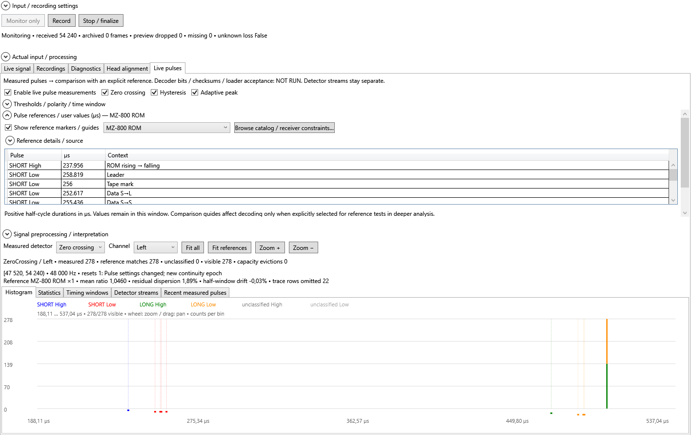

# Pulse reference picker and guide visibility — 2026-10-28

Approved scope: simple profile names, exact shared timing, service/technical variants
in the catalog only, aligned expanders, functioning guide visibility without restarting
measurement, contextual ROM tooltips, regression/UI checks and documentation.

## Selection and measurement

The shared reference control now uses 12 profile-oriented choices:

| Choices | Physical catalog data |
| --- | --- |
| MZ-800 ROM | rom800, all context-dependent guides |
| MZ-700 ROM (PAL), MZ-700 ROM (NTSC) | rom700pal / rom700ntsc |
| NORMAL 1:2, 1:3, 1:4 | ic2400 / ic2800 / ic3200; direct header and body context |
| IC 1:2, 1:3, 1:4 | the same three guide objects; FAST IPL body context |
| TC 1:2, 1:3 | exact current tc2 / tc3 rows used by the encoder |
| MZ-700 FAST3 | fast3 |

The underlying technical catalog retains its 15 comparison entries, all receiver
constraints, service nominal values, IC/TC 1:1 and TC compatibility provenance.
They are visible through Browse catalog / receiver constraints, not silently substituted
for the chosen profile. Source metadata is under a collapsed Reference details / source
expander. Loader labels (including IC FAST IPL), enum values, sidecar encoding and the
waveform encoder are unchanged by this UI refinement.

AudioPulseReferences.Choices projects the catalog without new pulse-number tables.
The NORMAL and IC aliases share the same Guide collection. Reference-test planning
uses a culture-independent key of exact group/duration pairs; names and explanatory
contexts do not create repeated classification passes. The 12 default aliases produce
nine unique physical reference tests, plus the existing ROM-header discovery pass.
User-defined durations remain editable. The live panel caches canonical physical
reference projections, preserving user provenance separately; changing IC/NORMAL aliases
with identical timing neither resets live measurement nor creates another stream.

## Visibility, alignment and ROM contexts

Show reference markers / guides has a separate display event. In live analysis it
changes only the chart; in visual/manual analysis it updates the overlay without
rebuilding the completed measurement. Both chart renderers show a time-axis strip
and light dotted vertical guides, with visibility controlled by the checkbox.
The offline automatic range still uses the same comparison domain when hidden, so
hiding guides cannot change the viewport. Explicit zoom/pan and measurement data stay
unchanged. The control has zero outer margin, aligned with adjacent expanders.

Hover details include the selected profile, group, scaled duration and actual context,
plus source provenance. Nearby overlapping guides are combined in the hover text;
the tooltip is offset from the pointer. MZ-800 ROM has four SHORT LOW contexts
(leader, tape mark, S→L, S→S) and three LONG LOW contexts (tape mark, L→L, L→S).
These are nine total guides including SHORT/LONG HIGH, not duplicate profiles.
At low zoom some same-color marks overlap. No averaging or deletion of exact ROM
contexts was introduced. The user may zoom to separate them.

## Verification

Two new unit cases pin the twelve names, hidden technical rows, shared IC/NORMAL guide
objects, exact TC values, nine unique physical references, and an actual AnalyzeRange
run with both aliases producing only header discovery plus one reference pass.
The technical catalog's identity/value/receiver tests and 39 waveform fingerprints
remain enabled.

The recorder STA smoke passes 79 checks. New checks cover marker hiding/restoration,
continuity and classifier identity, IC/NORMAL alias switching without restart,
all four SHORT LOW contexts in actual rendered hover hits and expander alignment.
The original audio STA smoke also passes; its new manual checks verify the same
completed result and histogram series objects and identical range when hiding/showing
guides. That test exposed and drove the automatic-range fix. It also exercises the
updated manual All/Selected profile list and prior custom references, zoom, navigation,
recovery/cancellation and report behavior. A first live-alias smoke assertion compared
a requested reference with the ViewModel's deliberately cloned immutable snapshot;
the corrected assertion compares identities within each ownership domain.

Release solution build: zero warnings/errors. Portable suite: 191 passed; Windows
integration: 44 passed. Final full legacy suite: 1165 passed / 0 failed / 3 fixture
skips. Combined unit total: **1400 passed / 0 failed / 3 skipped**. All 39 export
fingerprints match, with golden SHA-256 unchanged:
`7B142B0D300DFDAD731032E9DD8A55F900082F84A9789C41C05310EC0E94EB49`.
The same eight documented optional early-return branches remain. Unit reports are
in TestResults/PulseReferenceUiFinal (final legacy) and
TestResults/PulseReferenceUi (portable/Windows), ignored. The guide screenshot is from
MZTools.Capture.Windows.Tests/UiSmoke/bin/Release/net10.0-windows/smoke-artifacts/
af8e545bd5c9425ba3db93638965f669/reference-guides.png. The original audio STA run reported
local-temp artifacts mztools-audio-ui-a24490cca08245078b3141731963d134 and 12 pans in
53 ms for 501 visible buckets out of 65,536, a synthetic observation only.

No waveform pulse numbers, historical source analysis, fixtures, golden data, package
or version was changed. Physical capture and real per-monitor DPI remain unverified.
No commit, push or release was performed.

### Live histogram dragging and automatic reference fit (2026-10-28)

Dragging now uses the displayed range and plot width captured at mouse-down and
the total pointer displacement, rather than accumulating deltas against the last
measurement snapshot. Fast events between acquisition refreshes are not lost;
refreshes during a drag do not change its anchor. The drawing viewport updates
immediately, projecting existing histogram bins to their duration coordinates and
clipping them to the plot. Fresh measurements subsequently rebin the requested
range; capture/analysis remains on its existing schedule. The lower bound clamps
at zero without changing the range width or accumulating a boundary offset.

Selecting a reference, including an equivalent NORMAL/IC alias or a new user
reference, fits its exact scaled durations with 20% padding (minimum 1 µs).
This works before a measurement snapshot exists. Equivalent aliases still reuse
the classifier; guide visibility and channel changes still preserve the viewport.
Fit all remains available. Histogram zoom uses the latest requested range too.

Release solution build: zero warnings/errors. Recorder STA smoke: **86 checks
passed**, including seven new checks for fast dragging before refresh, immediate
drawing range, reversal after refresh, clamping/reversal at zero, automatic ROM fit
and automatic user-reference fit. Synthetic input only; no physical input tested.
Artifacts: MZTools.Capture.Windows.Tests/UiSmoke/bin/Release/net10.0-windows/
smoke-artifacts/6a0c427f61e04ea49e6d13cab4fe24e3. No dependency, PCM data, capture
transport or reference duration was changed in this block. The separately reported
shared-mode format rejection (48 kHz, stereo, 32-bit external input) remains under
investigation; this histogram change does not resolve that initialization failure.
