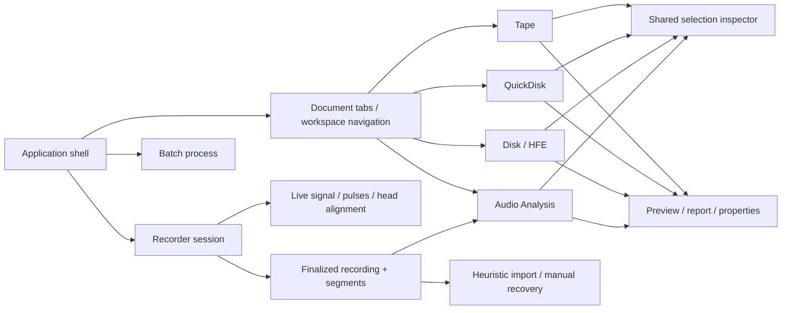
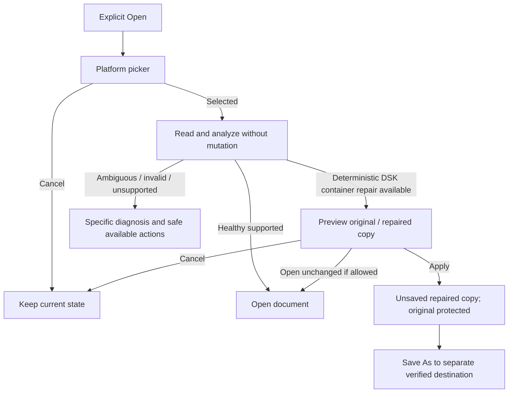

# Mapa obrazovek a workflow — návrh F2

## Shell a vlastnictví stavu

Každý dokument vlastní path, typ, modified/read-only stav, capability model, selected
IDs, poslední focus a viewport podle pohledu. Aktivace jiného dokumentu tyto hodnoty
nepřepisuje. Změna společných tokenů není změna modelů nebo algoritmů.
Recorder vlastní session a její lifecycle nezávisle na aktivním dokumentu. Inspector
sleduje kontext zvoleného workspace; jeho zavření neukončuje výpočet ani capture.
Samostatné okno je povolené pouze jako společný model „Open detail in window“:
stejné komponenty, jediný stav dokumentu/session, bez kopie výpočtů a bez WPF interopu.

## Open a ochrana pracovního dokumentu

Open není implicitní repair. Healthy DSK a trailing bytes se otevírají podle
současné politiky bez opravného dialogu. Nejednoznačná metadata, chybějící tracky,
FDC status či neplatná data se nepřepisují heuristikou kvůli hezčí mapě. HFE nemá
DSK Container Repair; filesystem repair má vlastní akce a preview. Rozpracovaný
aktivní dokument se nesmí ztratit kvůli Cancel, chybě načítání nebo odmítnuté opravě.

## Save / Save As / Export

1. Příkaz načte capability a prepared/modified stav aktivního dokumentu.
2. Uloží se jen validovaný připravený obsah; dlouhý výpočet má progress a cancellation.
3. Cíl se normalizuje, vyřeší kolize a ochrana originálu/odkazů; operační adaptér
   musí umět prokázat identitu nebo operaci bezpečně odmítnout.
4. Zápis a následné ověření proběhnou před změnou active path/dirty flag.
5. Save As po úspěchu přepne bound kopii. Export ponechá zdroj i modified beze změny.
6. Selhání ponechá původní path/dirty, uvede problém, dopad a bezpečný další krok.

Převod DSK↔HFE, variant HFE nebo export programu, regionu, raw sektoru, fyzického
streamu, COM či reportu jsou explicitní exporty. Tentýž název příkazu má tento význam
v každém modulu. Stávající [Save As audit](../SAVE_AS_DESTINATION_AUDIT.md) je baseline.

## Doménové cesty

| Vstup | Plocha a detail | Operace a návrat |
| --- | --- | --- |
| Tape MZF/M12/MZT a příslušné packed varianty | pořadí záznamů, header, profily, compression, hex | metadata/compression preview → Apply; export WAV/LEP/L16/COM/IPL zvlášť |
| QuickDisk QD/QDF/MZQ | logický seznam ↔ physical map / host inspector ↔ decoded/raw hex | podporované SHARP editace; export decoded unit oddělený od fyzického média; ostatní host capability beze změny |
| DSK/HFE | soubory ↔ sector map / surface ↔ CHRN/FDC/hex/structure | format/compare/repair/defrag/boot preview; citlivé oblasti explicitně potvrdit |
| Single/multi IPL | připravené programy, pořadí, LOAD/EXEC, limit, komprese | zrušit stale async preview; původní loader/header restrictions zachovat; disk až po validaci |
| Offline WAV/FLAC / `.wav.json` | waveform ↔ records/regions ↔ histogram/scatter/drift/levels | selected analysis → candidates/checksum evidence → explicitní MZF/raw/region export |
| Recorder | nastavení → Monitor nebo Record → immutable snapshots → Stop/finalize | WAV+JSON+segments → existující analýza/import/recovery jako celé recording |
| Batch | inputs + operation + output policy → preflight preview → Execute | per-file progress/cancel/results; zdroje zůstávají zachované |
| Profiles | existující layout/boot/pulse metadata | validace/provenance; built-in profily read-only, user copy oddělená |

## Dialogy, výpočty a hlášení

Běžný stav patří do status baru/inline banneru, nikoli do modal MessageBox.
Modalitu použít na nezbytné rozhodnutí, hrozící ztrátu dat nebo Apply preview.
Properties a report mají sdílený form/table pattern; nesouvisející modální řetězce
nahradit jedním cíleným preview. Složitý detail může mít samostatné okno podle
společného vzoru. Systémové pickery a permissions mohou vypadat nativně jinak.

Error obsahuje: konkrétní kód/problém, dotčený dokument/interval, dopad, dostupný
krok k nápravě, volitelně technický detail a export reportu. Příklad: „Source changed
after preview. No repair was applied. Reopen the image and review again.“ Žádné
„healthy“ jen proto, že se soubor zkompiloval nebo neznámý filesystem nehlásil chybu.

| Stav | UI význam | Povolené kroky |
| --- | --- | --- |
| healthy | doložené relevantní kontroly prošly | běžné schopnosti dokumentu; neznamená HW boot |
| repairable | existuje konkrétní bezpečný plán | preview, Apply do kopie, bezpečný Save As |
| ambiguous | data nemají jednoznačnou interpretaci | inspect/export originálu, žádná vymyšlená oprava |
| read-only | jasný důvod omezení | prohlížení a bezpečné exporty |
| incomplete | záznam/operace není kompletní | zachovat partial + report, explicitní omezení další práce |

Progress má popsanou fázi, vlastníka a Cancel. Zrušení UI čekání nemění význam
CaptureSession.StopAsync: acquired archiv se dofinalizuje podle stávajícího kontraktu.
Stale async výsledek nesmí aktualizovat zavřený view nebo přepsat novější preview.
Pro live rendering se při zátěži vynechá preview, nikdy se nezablokuje archivní callback.
